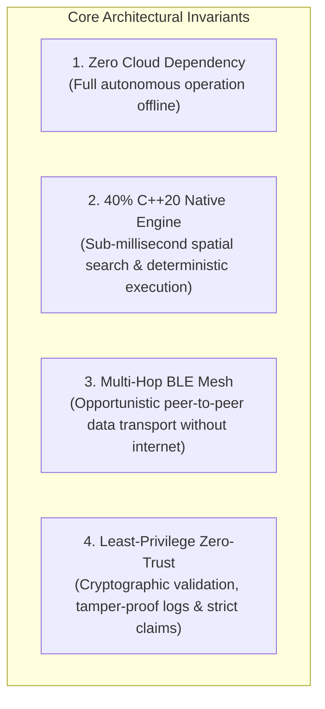

# 🏛️ GeoRescuX — System Architecture & Repository Blueprint

This document specifies the end-to-end system architecture, design invariants, data flows, and module responsibilities of **GeoRescuX**, an autonomous offline-first emergency response, P2P BLE mesh routing, and native C++20 spatial computing platform.

---

## 1. 🌐 Core Design Constraints & Engineering Rationale

When catastrophic natural disasters occur (e.g. Himalayan cloudbursts, flash floods, major earthquakes), infrastructure collapses in three successive phases:
1. **Physical Backhaul Severance**: Fiber backbones break and cellular Base Transceiver Stations (BTS) lose grid power.
2. **Bandwidth Collapse**: Any surviving towers suffer catastrophic congestion and packet loss.
3. **GPS Degradation & Multipath**: Mountain valleys and structural debris impede clean GNSS satellite locks.

To guarantee life-safety operations under these conditions, GeoRescuX enforces four core architectural invariants:



---

## 2. 🗺️ Monorepo Structure & Directory Justification

Every top-level directory in the repository fulfills a distinct, justified responsibility:

| Directory | Core Responsibility | Technologies | Architectural Justification |
| :--- | :--- | :--- | :--- |
| [`app/`](file:///c:/Users/sanid/Documents/GitHub/GeoRescuX/app) | Android Client Application | Kotlin 2.2, Android SDK 24+, C++20 NDK, JNI | Dual-role (Citizen & Field Responder / Admin) mobile client with offline-first local stores and foreground BLE mesh daemon. |
| [`app/src/main/cpp/`](file:///c:/Users/sanid/Documents/GitHub/GeoRescuX/app/src/main/cpp) | Native High-Performance Core | C++20, CMake, Android NDK | Memory-safe algorithms: A* pathfinding, KD-Tree spatial queries, 3D elevation impedance models, Bloom filter packet deduplication, and HMAC-SHA256 crypto. |
| [`backend/`](file:///c:/Users/sanid/Documents/GitHub/GeoRescuX/backend) | Dispatch & Simulation Backend | C++20, Drogon Framework, SQLite3 | High-throughput edge/cloud ingestion microservice, multi-victim DBSCAN clustering, Rothermel wildfire spread model, and hydrodynamic flood simulators. |
| [`functions/`](file:///c:/Users/sanid/Documents/GitHub/GeoRescuX/functions) | Cloud Functions Security Layer | Node.js, Firebase Admin SDK | Zero-trust admin minting, role verification, and server-side token claim revocation. |
| [`georescux-admin-provision/`](file:///c:/Users/sanid/Documents/GitHub/GeoRescuX/georescux-admin-provision) | Enterprise Admin Provisioning | Node.js, Firebase Admin SDK | Trusted out-of-band administration CLI scripts to mint, inspect, and revoke admin custom claims securely. |
| [`tools/`](file:///c:/Users/sanid/Documents/GitHub/GeoRescuX/tools) | Spatial Graph & Map Tooling | C++20, Java, CMake, OpenStreetMap | Offline extraction pipeline converting raw OpenStreetMap PBF files into optimized topological routing graphs and elevation matrices. |
| [`output/`](file:///c:/Users/sanid/Documents/GitHub/GeoRescuX/output) | Regional Graph Datasets | GeoJSON, OSM PBF, JSON | Partitioned offline datasets for critical mountain regions (Uttarakhand, Himachal Pradesh, Haryana, Uttar Pradesh). |
| [`docs/`](file:///c:/Users/sanid/Documents/GitHub/GeoRescuX/docs) | System Documentation | Markdown, Mermaid | Comprehensive system reference: architecture, testing reports, security audits, BLE subsystem specs, and demo guides. |
| [`Images/`](file:///c:/Users/sanid/Documents/GitHub/GeoRescuX/Images) | Visual Assets & UI Captures | JPEG, PNG | Production interface screenshots and visual guides. |

---

## 3. 🔄 System Tier Architecture

```mermaid
flowchart TB
    subgraph Tier1["1. Citizen & Field Responder Edge Tier"]
        UI[Material Design UI] --> VM[Jetpack ViewModels]
        VM --> REPO[Local-First Repositories]
        REPO --> STORE[(SharedPreferences / SQLite)]
        REPO --> JNI[Zero-Copy JNI Bridge]
        JNI --> NATIVE[C++20 Native Engine]
        NATIVE --> ASTAR[A* Safe Route Pathfinder]
        NATIVE --> ELEV[Elevation Cost Model]
        NATIVE --> BLOOM[Bloom Filter Deduplicator]
    end

    subgraph Tier2["2. P2P Bluetooth Low Energy Mesh Tier"]
        BLE_SVC[GeoRescueBleForegroundService]
        BLE_SVC <--> SCAN[BLE Central / Scanner]
        BLE_SVC <--> ADV[BLE Peripheral / Advertiser]
        SCAN <--> GOSSIP[Gossip Mesh Protocol (TTL=7)]
        ADV <--> GOSSIP
    end

    subgraph Tier3["3. High-Throughput Ingestion Microservice"]
        DROGON[Drogon C++20 HTTP Engine]
        DROGON --> DBSCAN[DBSCAN Incident Clusterer]
        DROGON --> SIM[Disaster Spread Simulators]
        DROGON --> SQLITE[(Durable Backend SQLite)]
    end

    subgraph Tier4["4. Enterprise Cloud & Security Tier"]
        FB_AUTH[Firebase Authentication]
        FB_RULES[(Least-Privilege RTDB Rules)]
        ADMIN_CLI[georescux-admin-provision]
        FUNCTIONS[Firebase Cloud Functions]
        ADMIN_CLI -->|Mint Admin Claim| FB_AUTH
        FB_AUTH -->|JWT with Claims| FB_RULES
    end

    Tier1 <==>|Ad-hoc P2P BLE Packets| Tier2
    Tier2 ==>|Opportunistic Gateway Uplink| Tier3
    Tier1 ==>|Direct Uplink when Online| Tier4
    Tier3 <==>|Telemetry Reconciliation| Tier4
```

---

## 4. 🧩 Android Client Clean Architecture

The Android application (`app/`) strictly follows the **Clean Architecture** and **MVVM (Model-View-ViewModel)** paradigms:

```
app/src/main/kotlin/com/example/georescux/
├── ui/                   # PRESENTATION LAYER
│   ├── home/             # HomeActivity: Status cards, 2x3 quick grid, mesh telemetry
│   ├── sos/              # SosActivity: Emergency countdown, active SOS HUD, cancel trigger
│   ├── routing/          # RouteActivity: Offline evacuation navigation, turn-by-turn guidance
│   ├── map/              # MapActivity: Offline vector map, hazard overlay, quick filters
│   ├── alerts/           # AlertsActivity: Weather alerts, admin advisories, emergency history
│   ├── contacts/         # ContactsActivity: ICE contacts and one-touch emergency dialers
│   ├── admin/            # AdminDashboardActivity, AdminMapActivity, AdminUsersActivity
│   ├── ble/              # BleDiagnosticsActivity: Two-device mesh laboratory & packet log
│   └── common/           # BottomNav, ActiveSosBanner, ConnectivityBadge, TopBar
│
├── domain/               # DOMAIN LAYER (Zero Framework Dependencies)
│   ├── routing/          # RouteGraph, AStarPathfinder, RouteCostPolicy, NearestNode
│   ├── sos/              # SosStateMachine, SosEmergency, SosLocationPolicy, UseCases
│   ├── ble/              # GeoRescueBleMeshNode, GeoRescueBlePacket, GeoRescueBleFramer
│   ├── contacts/         # EmergencyContact, ContactRules
│   ├── hazard/           # HazardCorroboration, RoadHazard
│   └── triage/           # IncidentTriage, EmergencyPriorityScore
│
├── data/                 # DATA & INFRASTRUCTURE LAYER
│   ├── routing/          # RouteRepositoryImpl, GeoRescueNativeRouting, GraphStore
│   ├── sos/              # SosRepositoryImpl, SharedPreferencesSosStore, BleBridge
│   ├── ble/              # GeoRescueBleForegroundService, RelayConnectionManager
│   └── sync/             # SyncRetryCoordinator, WorkManagerSyncScheduler, CloudDataSources
```

---

## 5. ⚡ C++20 Native Spatial Engine (`app/src/main/cpp/`)

The native engine is compiled directly with modern flags (`-std=c++20 -O3 -flto`):

1. **`routing/AStarPathfinder.cpp`**: Shortest-path pathfinding over regional OSM graphs with admissible Haversine heuristics and pre-reserved state tables.
2. **`routing/RouteGraph.cpp`**: $O(1)$ adjacency indexing and neighbor lookups for near-instant edge resolution.
3. **`spatial/ElevationCostModel.cpp`**: 3D elevation impedance model incorporating slope gradient, altitude fatigue, and victim physical mobility constraints.
4. **`crypto/PacketAuthenticator.cpp`**: Hardware-accelerated HMAC-SHA256 signature generation and constant-time verification for emergency broadcast packets.
5. **`mesh/BloomFilterDeduplicator.cpp`**: Space-efficient probabilistic filter suppressing cyclic mesh re-broadcast storms across thousands of nodes.
6. **`spatial/KDTree.cpp` & `spatial/GeodesicMath.cpp`**: Fast nearest-neighbor spatial queries and Vincenty / Haversine high-precision geodesic calculations.

---

## 6. 🛡️ Enterprise Security Model & Rule Validation

The Firebase Realtime Database rules (`database.rules.json`) enforce zero-trust access controls:
- **Normal Citizen Access**: Read and write restricted strictly to `auth.uid == $uid`. SOS alerts can only transition from `ACTIVE` to `COMPLETED`. No deletion permitted.
- **Admin Access**: Authenticated exclusively via cryptographic JWT custom claim (`auth.token.admin == true`). Admins can triage and resolve incidents (`status = 'RESOLVED'`), but are forbidden from modifying citizen GPS coordinates or tampering with emergency logs.
- **Verification Suite**: 39 automated integration tests (`app/src/test/resources/run_emulator_rules_tests.js`) validate all read/write paths against the Firebase Local Emulator.
