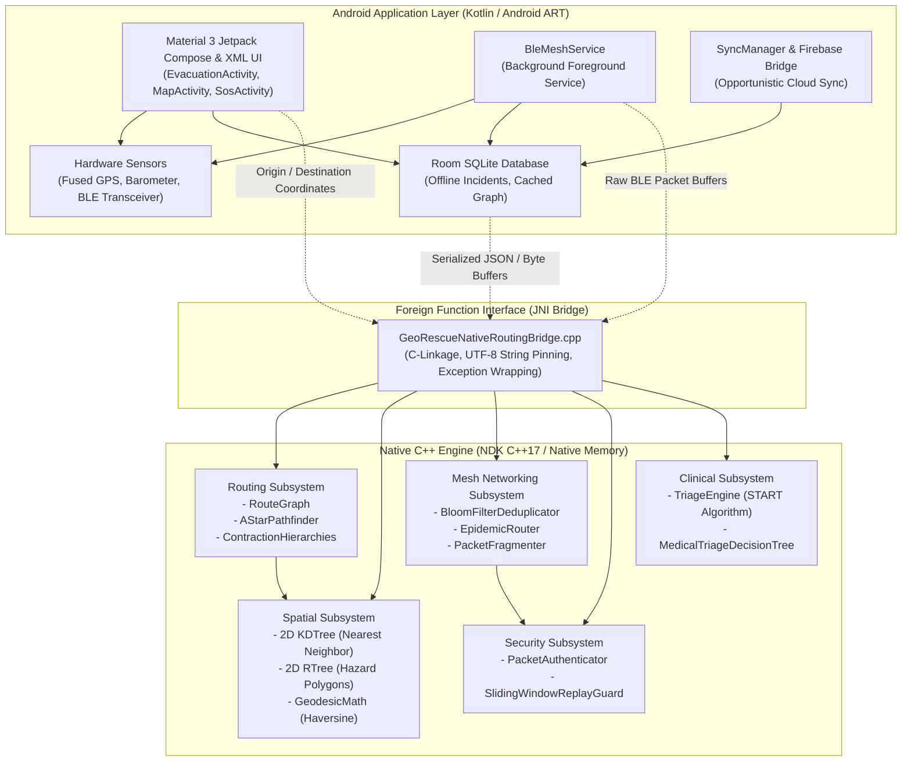
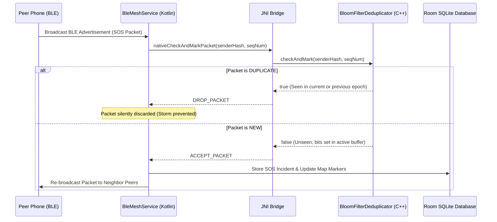
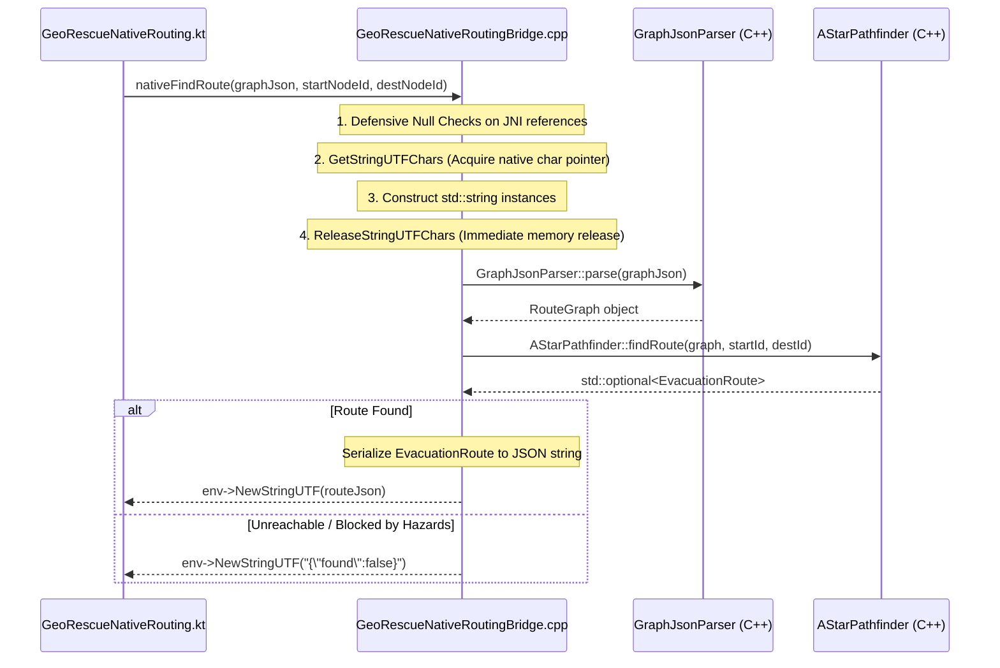

# GeoRescuX — System Architecture & Technical Specification

**Project Title:** GeoRescuX: Tactical Offline-First Disaster Evacuation & Mesh Communication System  
**Repository:** `https://github.com/sanid28/GeoRescuX`  
**Package:** `com.example.georescux`  
**Platform:** Android (NDK C++17 + Kotlin)  

---

## 1. Executive Architectural Blueprint

GeoRescuX is engineered around an **Offline-First, Dual-Layer Architecture** designed to operate deterministically in total communications blackouts (collapsed cellular towers, severed fiber optics, and lost power grids).

---

## 2. The Dual-Layer Separation of Concerns

### Why Split Between Kotlin and Native C++?
The application intentionally separates user experience and operating system integration from algorithmic execution:

| Characteristic | Android Kotlin Layer (ART VM) | Native C++ Layer (NDK) |
|---|---|---|
| **Primary Domain** | Android lifecycle, UI widgets, permissions, sensor interrupts, background service management. | Algorithmic pathfinding, spatial indexing, packet deduplication, bitfield manipulation. |
| **Memory Model** | Managed heap with garbage collection (GC pauses). | Native heap and stack memory with deterministic RAII deallocation. |
| **Execution Speed** | Bytecode executed via Android ART with JIT/AOT compilation. | Direct native ARM64/x86_64 machine code compiled via Clang with `-O3` vectorization. |
| **Fault Isolation** | High-level business logic and fallback coordinators (`SafeHavenFallback.kt`). | Wrapped in exception boundaries to prevent native abort signals (`SIGABRT`, `SIGSEGV`). |

---

## 3. Native C++ Subsystems Deep Dive

### Subsystem 1: Disaster Graph & Evacuation Routing
- **Primary Headers:** `routing/RouteGraph.h`, `routing/AStarPathfinder.h`, `routing/RouteCostPolicy.h`
- **Data Model:**
  - `RouteNode`: Geographic intersection with latitude, longitude, and elevation.
  - `RouteEdge`: Physical road segment connecting two nodes with distance, road type (highway, arterial, pedestrian), and slope.
  - `RoadHazard`: Active disaster impediment (landslide, flood, collapsed bridge).
- **Adjacency Representation:**
  Stored as an internal hash map:
  `std::unordered_map<std::string, std::vector<std::pair<RouteEdge, RouteNode>>> adjacency;`
  Enables instant $O(1)$ neighbor retrieval during frontier expansion.
- **Cost Formulation:**
  $$\text{EffectiveCost}(e) = \text{Distance}(e) \times \text{RoadImpedance}(e) + \text{HazardPenalty}(e) + \text{ElevationImpedance}(e)$$
  If a hazard completely blocks the edge, the cost function returns `std::nullopt`, pruning that segment from the search graph.

### Subsystem 2: Spatial Indexing & Geodesic Geometry
- **Primary Headers:** `spatial/KDTree.h`, `spatial/RTree.h`, `spatial/GeodesicMath.h`
- **2D KD-Tree:**
  - Snaps raw unconstrained GPS coordinates to the nearest valid graph node in $O(\log N)$ time.
  - Recursively alternates splitting planes between Latitude and Longitude at each tree depth.
  - Movable-only semantics with deleted copy constructor prevents tree cloning overhead.
- **Haversine Distance Formulation:**
  Computes spherical great-circle distance between coordinates $(\phi_1, \lambda_1)$ and $(\phi_2, \lambda_2)$:
  $$a = \sin^2\left(\frac{\Delta \phi}{2}\right) + \cos(\phi_1)\cos(\phi_2)\sin^2\left(\frac{\Delta \lambda}{2}\right)$$
  $$c = 2 \cdot \arctan2(\sqrt{a}, \sqrt{1-a})$$
  $$d = R \cdot c \quad (\text{where } R = 6,371,000 \text{ meters})$$

### Subsystem 3: Bluetooth Low Energy Mesh & Deduplication
- **Primary Headers:** `mesh/BloomFilterDeduplicator.h`, `mesh/EpidemicRouter.h`, `mesh/MeshPacketCodec.h`
- **The Problem:** In a dense disaster zone with hundreds of phones broadcasting emergency messages, naive flooding causes radio channel saturation (broadcast storms), dropping life-critical packets.
- **The Solution:** Double-buffered rolling Bloom filter with 65,536 bits (8 KB) and 4 independent hash functions.
  - **Memory Footprint:** Under 64 KB total RAM.
  - **Deduplication Speed:** $O(1)$ constant time bitwise check (`buf[idx / 64] & (1ULL << (idx % 64))`).
  - **Epoch Rotation:** Automatically shifts the active buffer to the previous buffer every 300 seconds, evicting expired packets without memory allocations or garbage collection.

### Subsystem 4: Cryptographic Authenticity & Replay Protection
- **Primary Headers:** `crypto/PacketAuthenticator.h`, `crypto/SlidingWindowReplayGuard.h`
- **Threat Vector:** Rogue actors or corrupted nodes injecting false evacuation orders or replaying stale SOS messages.
- **Defense Mechanism:**
  - **HMAC Authentication:** Packets are signed using HMAC-SHA256 truncated to 8 bytes for BLE payload efficiency.
  - **Sliding Window Replay Guard:** Maintains a 64-packet bitmask and monotonically increasing sequence number threshold. Stale or replayed packets outside the valid sequence window are instantly rejected.

### Subsystem 5: START Clinical Disaster Triage Engine
- **Primary Headers:** `triage/TriageEngine.h`, `triage/MedicalTriageDecisionTree.h`
- **Clinical Standard:** Implements the international **Simple Triage and Rapid Treatment (START)** protocol:
  1. **Step 1 (Mobility):** Can the victim walk?
     - *Yes* $\rightarrow$ **GREEN (Minor / Walking Wounded)**.
  2. **Step 2 (Respiration):** Spontaneous breathing present?
     - *No after airway positioning* $\rightarrow$ **BLACK (Deceased / Expectant)**.
     - *Yes, rate > 30 breaths/min* $\rightarrow$ **RED (Immediate)**.
  3. **Step 3 (Perfusion):** Radial pulse present / capillary refill $\le 2$ seconds?
     - *No* $\rightarrow$ **RED (Immediate)**.
  4. **Step 4 (Mental Status):** Can follow simple commands?
     - *No* $\rightarrow$ **RED (Immediate)**.
     - *Yes* $\rightarrow$ **YELLOW (Delayed)**.

---

## 4. JNI Interoperability & Data Marshalling Protocol

The bridge between Kotlin and C++ is established in [GeoRescueNativeRoutingBridge.cpp](file:///c:/Users/sanid/Documents/GitHub/GeoRescuX/app/src/main/cpp/jni/GeoRescueNativeRoutingBridge.cpp).

### Memory Management & Exception Safety in JNI:
1. **Zero Memory Leaks:** Every call to `env->GetStringUTFChars()` is strictly paired with `env->ReleaseStringUTFChars()` in the same execution scope.
2. **Crash Prevention (`try / catch`):** All native algorithm logic is enclosed in C++ `try { ... } catch (const std::exception& e)` blocks. Any unhandled exception is caught and serialized into a structured JSON error string instead of causing an uncatchable Android process crash (`SIGABRT`).
3. **Safe Kotlin Fallback:** If `isAvailable()` returns false, Kotlin automatically routes queries through `SafeHavenFallback.kt`.

---

## 5. Offline Mapping Subsystem Architecture

GeoRescuX does not rely on raster map tiles downloaded over HTTP. It uses **Mapsforge binary vector files** (`.map`) and offline road graph databases for the four officially supported states:

| State | Role | Map Package File | File Size | Coverage Highlights |
|---|---|---|---|---|
| **Uttarakhand** | Primary High-Risk Region | `uttarakhand.map` | ~138 MB | Dehradun, Rishikesh, Haridwar, Kedarnath, Badrinath, Nainital, Bhimtal. |
| **Himachal Pradesh** | Secondary High-Risk Region | `himachal_pradesh.map` | ~68 MB | Shimla, Manali, Kullu, Dharamshala, Mandi, Solan. |
| **Haryana** | Relief & Evacuation Corridor | `haryana.map` | ~82 MB | Ambala, Panipat, Karnal, Rohtak, Gurugram bypass. |
| **Uttar Pradesh** | Logistics & Evacuation Basin | `uttar_pradesh.map` | ~379 MB | Meerut, Ghaziabad, Moradabad, Bareilly, Lucknow corridor. |

### Map Rendering Pipeline:
1. **Direct File I/O:** Mapsforge vector reader reads binary geographic geometry (polygons, lines, points) directly from external app storage (`/Android/data/com.example.georescux/files/map_packages/`).
2. **On-Device Rasterization:** The OsmDroid rendering canvas rasterizes vector geometry into screen pixels on the hardware GPU in real time.
3. **Hazard Overlay Layer:** Dynamic landslide and flood hazard zones are drawn on top of the vector map using custom semi-transparent polygon layers (`HazardOverlay.kt`).

---

## 6. Verification & Quality Evidence

The GeoRescuX architecture has been validated against strict engineering benchmarks:
- **Unit Test Suite:** **631 passed out of 631 tests** in `testDebugUnitTest` (100% pass rate).
- **Static Analysis:** Android Lint verified with **0 Errors**.
- **Compiler Flags:** Compiled under `-Wall -Wextra -Werror` with C++17 compliance.
- **Runtime Stability:** Verified on physical and Pixel 6 emulator devices across flight mode and zero-network conditions.
