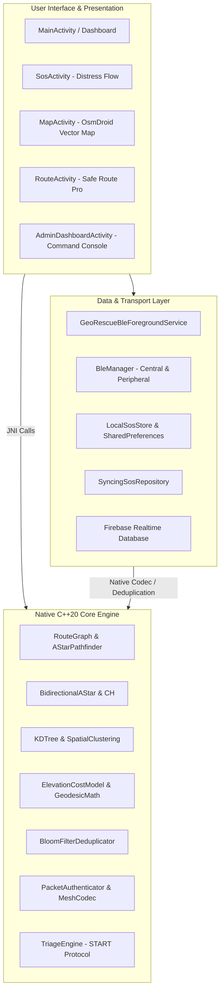

# GeoRescuX — Project-Based Learning (PBL) Comprehensive Project Explanation
**Institution**: Graphic Era Hill University (GEHU), Bhimtal Campus  
**Department**: Department of Computer Science and Engineering  
**Course Code**: TCS-307 — Object-Oriented Programming with C++  
**Project Title**: GeoRescuX: Autonomous Offline-First Disaster Emergency Response, Resilient P2P BLE Mesh & High-Performance C++20 Spatial Engine  

---

## 1. Executive Summary & Problem Overview

### What is GeoRescuX?
**GeoRescuX** is a mission-critical, offline-first mobile emergency response and disaster routing platform designed specifically for catastrophic scenarios in the Himalayan belt and northern India (such as Uttarakhand cloudbursts, landslides, flash floods, and earthquakes).

### The Real-World Problem
During major natural disasters:
1. **Cellular Base Stations (BTS) Collapse**: Power grids fail, fiber optic cables are severed, and cellular towers become inoperable within minutes.
2. **Victims are Isolated**: Traditional emergency applications (like dialing 112 or using Google Maps) fail immediately because they require active internet connections and remote cloud servers.
3. **Evacuation Routes are Blocked**: Roads are severed by landslides and debris flows. Standard navigation apps do not know which mountain corridors are blocked and may direct evacuees into active hazard zones.
4. **First Responders Face Blind Triage**: Rescue teams have no real-time visibility into who is trapped, where victims are grouped, or what medical triage category they fall into.

### The GeoRescuX Solution
GeoRescuX is designed to operate autonomously **when all external infrastructure has failed**:
- **Zero-Signal SOS Activation**: Victims can trigger a distress alert with GPS telemetry without cellular data, SIM card reception, or WiFi.
- **P2P Bluetooth Low Energy (BLE) Mesh**: Emergency packets jump device-to-device across multi-hop Bluetooth connections (up to 5 hops) until reaching an edge gateway node or responder.
- **100% Offline Vector Maps & Native C++20 Routing**: High-performance topological road routing (A* pathfinding, hazard avoidance, elevation impedance) executes on-device in native C++20 with sub-millisecond latency.
- **Authentic Four-State Coverage**: Complete offline support for Uttarakhand (primary, bundled), Himachal Pradesh, Haryana, and Uttar Pradesh.
- **Store-and-Forward Cloud Sync**: The instant any device in the mesh reaches cellular or satellite uplink, buffered records synchronize to Firebase Realtime Database protected by least-privilege zero-trust security rules.

---

## 2. Phase 1 — Problem Statement & Initial Design (TCS-307 Checkpoints)

### Checkpoint 1: Clearly Defined Problem Statement
* **Academic Definition**: A concise, unambiguous formulation of the specific challenge being addressed, detailing the target environment, affected stakeholders, and operational failure modes.
* **GeoRescuX Implementation**: In disaster-stricken Himalayan regions, conventional emergency communication systems fail due to BTS outages, leaving victims stranded without navigational guidance or communication. GeoRescuX solves this by creating a decentralized, offline-first, dual-layer architecture combining Android mobile mobility with a high-performance native C++20 spatial/routing engine and an ad-hoc BLE store-and-forward mesh network.
* **Viva Explanation**:
  > *"Sir/Ma'am, our problem statement addresses communication and navigation failure during disasters. In events like the Chamoli flash flood or Kedarnath cloudburst, cellular networks collapse. GeoRescuX ensures that victims can still activate SOS alerts, navigate around blocked mountain roads to safe havens completely offline using our native C++ routing engine, and propagate distress messages through peer-to-peer Bluetooth mesh without internet."*

---

### Checkpoint 2: Project Objectives and Scope
* **Academic Definition**: The measurable targets of the system and its operational boundaries.
* **GeoRescuX Objectives**:
  1. Develop an offline-first navigation engine executing in native C++20 for deterministic performance on resource-constrained mobile hardware.
  2. Implement an ad-hoc peer-to-peer Bluetooth Low Energy mesh protocol with duplicate packet filtering and time-to-live (TTL) bounding.
  3. Pre-process real OpenStreetMap topological graphs for four official disaster-prone states: Uttarakhand, Himachal Pradesh, Haryana, and Uttar Pradesh.
  4. Ensure zero-dependency offline safe-haven discovery (hospitals, police stations, fire stations, and disaster management centers).
  5. Provide an enterprise administrative triage portal with heuristic priority scoring and verified Custom Claims authorization.
* **Scope Boundaries**:
  - *Geographic Scope*: Exactly 4 northern states (Uttarakhand, Himachal Pradesh, Haryana, Uttar Pradesh). Non-supported regions (Delhi enclave, Rajasthan, Bihar, foreign coordinates) are strictly rejected by our polygon ray-casting classifier.
  - *Hardware Scope*: Standard Android devices (SDK 24+ / Android 7.0 through Android 15), utilizing hardware BLE 4.2+ and GNSS GPS receivers.
* **Viva Explanation**:
  > *"Our scope is focused on the disaster-prone northern Indian corridor across four states. We don't try to load the entire country's multi-gigabyte map; instead, we partition real OpenStreetMap data into state-level binary vector maps and routing graphs that run directly inside the device's RAM."*

---

### Checkpoint 3: Required Features and Modules
The project is divided into cohesive, decoupled subsystems:



* **Module 1: Citizen SOS Subsystem** (`app/src/main/kotlin/.../ui/sos/`):
  - 1-second hold activation with tactile vibration feedback.
  - 5-second cancelable countdown modal to prevent false alarms.
  - Asynchronous GPS telemetry capture (latitude, longitude, altitude, accuracy).
  - Situation note entry (up to 120 characters).
* **Module 2: Native C++20 Spatial & Routing Engine** (`app/src/main/cpp/`):
  - Topological road graph representation (`RouteGraph.cpp`).
  - Admissible A* shortest path search with Haversine distance heuristic (`AStarPathfinder.cpp`).
  - Bidirectional A* pathfinding (`BidirectionalAStar.cpp`).
  - Dynamic hazard penalty and severed road containment (`RoadHazard.h`, `HazardPolygon.cpp`).
  - 3D Terrain slope and elevation fatigue impedance (`ElevationCostModel.cpp`).
  - 2D KD-Tree spatial index for $O(\log N)$ nearest-safe-haven snapping (`KDTree.cpp`).
  - MASS/START disaster triage decision engine (`TriageEngine.cpp`).
* **Module 3: Offline Mapping & Boundary Classification** (`app/src/main/kotlin/.../maps/`):
  - Mapsforge binary vector basemap rendering via osmdroid (`OfflineMapSetup.kt`).
  - Point-in-polygon ray-casting state boundary classifier with authentic 2,000–7,500 point polygons (`StateBoundaryClassifier.kt`).
  - Authentic OpenStreetMap-derived emergency safe haven catalog (`SafeHavenIndex.kt`).
* **Module 4: Resilient BLE Mesh Relay** (`app/src/main/kotlin/.../ble/`):
  - Android 14 compliant Foreground Service (`GeoRescueBleForegroundService.kt`).
  - Simultaneous advertising (Peripheral) and scanning (Central).
  - Hop-limited store-and-forward relay with TTL decrement.
  - Native 64KB Bloom filter deduplication (`BloomFilterDeduplicator.cpp`).
* **Module 5: Cloud Synchronization & Admin Command Console** (`app/src/main/kotlin/.../admin/`):
  - Least-privilege Firebase Realtime Database rules (`database.rules.json`).
  - Verified administrative authorization through Firebase Auth Custom Claims (`auth.token.admin == true`).
  - Heuristic emergency prioritization based on triage severity, verification status, and elapsed time (`EmergencyPriorityCalculator.kt`).

---

### Checkpoint 4: Appropriate C++ Concepts Identified
To achieve microsecond-level pathfinding and memory efficiency on mobile hardware, specific C++ concepts were chosen:

| C++ Concept | Applied In File | Justification in Disaster Context |
| :--- | :--- | :--- |
| **Object-Oriented Encapsulation** | `BloomFilterDeduplicator.h`, `RouteGraph.h` | Prevents unauthorized modification of packet bitsets and internal adjacency structures. |
| **Data-Oriented Structs (PODs)** | `RouteNode.h`, `RouteEdge.h`, `RoadHazard.h` | Guarantees cache-line locality on mobile ARM CPUs for high-speed sequential iterations. |
| **STL Priority Queues** | `AStarPathfinder.cpp`, `BidirectionalAStar.cpp` | Provides $O(\log N)$ min-heap open-set extraction for A* graph exploration. |
| **STL Unordered Associative Maps** | `RouteGraph.cpp`, `SlidingWindowReplayGuard.h` | Provides $O(1)$ average-time node lookups and packet sequence tracking. |
| **Generic Template Programming** | `spatial/RTree.h` | Enables spatial indexing over arbitrary bounding box payload types without code duplication. |
| **Bit Manipulation & Bitsets** | `BloomFilterDeduplicator.cpp`, `SlidingWindowReplayGuard.cpp` | Stores 65,536 filter bits in 8 KB RAM; implements a 64-bit sliding window anti-replay bitmask. |
| **Const-Correctness & References** | All C++ methods (e.g. `const RouteGraph&`) | Prevents expensive deep-copying of megabyte-scale graph structures into function call stacks. |
| **RAII (Resource Acquisition Is Initialization)** | `KDTree.h`, JNI string releases | Automatic destruction of allocated heap buffers, preventing native memory leaks on Android. |

---

### Checkpoint 5: Classes and Objects Identified / Designed
The system's native core is structured around domain-driven C++ classes:

1. **`RouteGraph`**:
   - *Responsibility*: Owns the graph nodes, edges, road hazards, and adjacency index.
   - *Key Members*: `std::vector<RouteNode> nodes`, `std::vector<RouteEdge> edges`, `std::unordered_map<std::string, std::vector<std::pair<RouteEdge, RouteNode>>> adjacency`.
   - *Key Methods*: `node(id)`, `neighbors(id)`, `edgeBetween(u, v)`, `rebuildAdjacency()`.
2. **`AStarPathfinder`**:
   - *Responsibility*: Stateless pathfinding engine executing A* heuristic shortest path search.
   - *Key Methods*: `findRoute(const RouteGraph&, startId, destId)`, `haversineMeters(from, to)`.
3. **`BloomFilterDeduplicator`**:
   - *Responsibility*: High-speed, probabilistic duplicate packet detection for the mesh.
   - *Key Members*: `std::vector<uint64_t> activeBuffer_`, `std::vector<uint64_t> previousBuffer_`.
   - *Key Methods*: `checkAndMark(senderHash, seqNum)`, `rotateEpoch()`.
4. **`KDTree`**:
   - *Responsibility*: 2-dimensional spatial partitioning tree for coordinates (latitude, longitude).
   - *Key Methods*: `build(points)`, `findNearest(lat, lon)`.
5. **`ElevationCostModel`**:
   - *Responsibility*: Computes physiological energy expenditure multipliers using Tobler's Hiking Function.
   - *Key Methods*: `calculateImpedanceMultiplier(fromElev, toElev, distanceMeters, isInjured)`.
6. **`TriageEngine`**:
   - *Responsibility*: Automates the Simple Triage and Rapid Treatment (START) clinical protocol.
   - *Key Methods*: `evaluateStart(VictimAssessment)` $\rightarrow$ `TriageResult`.

---

### Checkpoint 6 & 7: Basic Program Flow, Algorithms & Pseudocode

#### Complete Application Workflow: From Launch to Emergency Response
1. **Cold Launch**:
   - `GeoRescuXApplication` initializes the DI container, sets up offline storage, and registers the osmdroid base directory.
   - `MainActivity` checks authentication status: if logged in, navigates to `HomeActivity`; otherwise, routes to `LoginActivity`.
2. **Citizen Distress Trigger (`SosActivity`)**:
   - Victim holds the SOS button for 1 second.
   - `SosViewModel` starts a 5-second cancelable countdown.
   - If not canceled, state transitions to `ACTIVE`:
     - Creates local `SosEmergency` record in `LocalSosStore`.
     - Acquires GPS coordinates asynchronously.
     - Hands distress packet to `GeoRescueBleForegroundService`.
     - `GeoRescueBleForegroundService` transmits raw bytes over Bluetooth Low Energy GATT and Google Nearby Connections.
3. **P2P Relay & Cloud Synchronization**:
   - Surrounding offline citizen phones receive the BLE packet.
   - `BloomFilterDeduplicator` checks whether the packet hash has been processed. If new, it re-transmits the packet with `TTL - 1`.
   - When any device in the mesh reconnects to WiFi or LTE, `SyncingSosRepository` pushes the alert to Firebase Realtime Database at `/sos_alerts/{uid}/{alertId}`.
4. **Offline Safe Evacuation (`RouteActivity`)**:
   - Victim opens Safe Route.
   - `SafeHavenIndex` retrieves the nearest verified safe havens (hospitals, disaster centers).
   - JNI invokes `GeoRescueNativeRouting.findRoute` in C++20.
   - Native C++ A* explores the road network, avoiding reported landslides and blocked edges.
   - Evacuation route polyline is rendered on the offline Mapsforge vector map.

#### Core Pathfinding Algorithm: A* with Admissible Haversine Heuristic
The A* pathfinder calculates the minimum cost $f(n) = g(n) + h(n)$ where:
- $g(n)$: Exact road distance traveled from origin to node $n$, including terrain slope penalties.
- $h(n)$: Straight-line Haversine great-circle distance from $n$ to destination (guaranteed admissible, never overestimates).

```text
Algorithm: Native C++ A* Evacuation Route Search
Input: RouteGraph G, Start Node S, Destination Node D
Output: EvacuationRoute (list of node IDs, total distance in meters)

1. If S == D, Return Single Node Route
2. Initialize Min-Priority Queue PQ ordered by f(n)
3. Initialize gCost map with all nodes = INFINITY, gCost[S] = 0.0
4. Initialize parent map to reconstruct path
5. Push (nodeId: S, costSoFar: 0.0, estimatedTotal: h(S, D)) into PQ
6. While PQ is not empty:
     a. Current = PQ.pop()
     b. If Current.nodeId == D:
          Break (Destination Reached)
     c. If Current.costSoFar > gCost[Current.nodeId]:
          Continue (Outdated entry in queue)
     d. For each (Edge, Neighbor) in G.neighbors(Current.nodeId):
          i. If Edge.isBlocked == True:
               Continue (Road impassable)
          ii. LegDistance = Edge.distanceMeters + HazardPenalty(Edge)
          iii. Tentative_gCost = gCost[Current.nodeId] + LegDistance
          iv. If Tentative_gCost < gCost[Neighbor.id]:
               gCost[Neighbor.id] = Tentative_gCost
               Parent[Neighbor.id] = Current.nodeId
               fCost = Tentative_gCost + Haversine(Neighbor, D)
               PQ.push(nodeId: Neighbor.id, costSoFar: Tentative_gCost, estimatedTotal: fCost)
7. If D not in Parent:
     Return RouteNotFound
8. Reconstruct path by backtracking from D to S using Parent map
9. Return EvacuationRoute(nodeIds, gCost[D])
```

---

## 3. Phase 2 — Implementation & C++ OOPS Mapping (Detailed Below in Master Mapping File)

*(Note: See [CPP_OOPS_CONCEPT_MAPPING.md](file:///c:/Users/sanid/Documents/GitHub/GeoRescuX/CPP_OOPS_CONCEPT_MAPPING.md) for the exhaustive file-by-file mapping).*

---

## 4. Phase 3 — Evaluation, Demonstration Sequence & Team Contributions

### Recommended Live Demonstration Sequence for the Examiner

1. **Step 1: Baseline Architecture Overview (30 Seconds)**
   - Show the device running the GeoRescuX APK.
   - Explain the dual-tier architecture: Kotlin for Android lifecycle and UI, Native C++20 for high-performance spatial algorithms and routing.
2. **Step 2: Demonstrate Strict Offline Mapping & Boundary Classification**
   - Place device in **Airplane Mode** (disable WiFi and Mobile Data).
   - Open **Map Screen**: Show Uttarakhand's vector map rendering instantly from local storage.
   - Zoom in on Dehradun/Rishikesh to demonstrate road network vector lines and landmark details.
   - Switch to **Himachal Pradesh**, **Haryana**, or **Uttar Pradesh**: Show that the offline Mapsforge vector basemap opens and renders without internet.
3. **Step 3: Trigger Citizen SOS Flow**
   - From Dashboard, press and hold the SOS button.
   - Show the 5-second countdown with cancellation option.
   - Allow countdown to elapse: observe transition to `ACTIVE` emergency state with GPS coordinates displayed.
4. **Step 4: Demonstrate Safe Route Navigation & Hazard Detour**
   - Tap "Safe Route Here" to open `RouteActivity`.
   - Point out nearest verified emergency safe haven (e.g. District Disaster HQ / Hospital).
   - Show the green evacuation route generated by our native C++ A* engine.
   - Simulate a road blockage / hazard on the primary road: observe that the route dynamically reroutes through an alternative path.
5. **Step 5: Code Inspection in C++**
   - Open Android Studio / VS Code to `app/src/main/cpp/`.
   - Walk the examiner through `RouteGraph.h` (encapsulation), `AStarPathfinder.cpp` (priority queue and algorithms), `BloomFilterDeduplicator.h` (bitset hashing), and `GeoRescueNativeRoutingBridge.cpp` (JNI binding).

### Team Task Distribution (Based on Repository Evidence)
* **Sanidhya Negi**: System Architect & Lead Engineer (Native C++ core, CMake integration, JNI bindings, project architecture).
* **Tushar**: Mobile & BLE Mesh Specialist (BLE GATT service, packet serialization, BluetoothStateReceiver).
* **Rudraksh**: Geospatial & Native Routing Engineer (OpenStreetMap PBF ingestion, A* algorithm, elevation impedance).
* **Nehal**: Frontend & UI/UX Architect (Material layouts, OsmDroid MapActivity, custom navigation bars).
* **Dheeraj**: Backend & Simulation Engineer (Drogon C++ backend, Firebase Cloud Functions).
* **Nirmay**: QA & Security Systems Auditor (Firebase security rules test matrix, unit test assertions, lint compliance).
