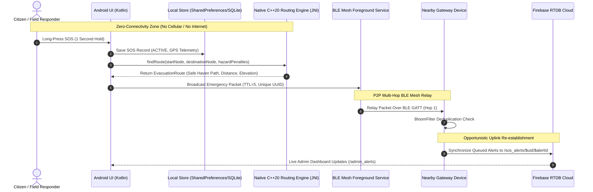

# GeoRescuX — Project-Based Learning (PBL) Comprehensive Explanation
**Course**: TCS-307: Object Oriented Programming with C++  
**Department**: Computer Science & Engineering  
**Institution**: Graphic Era Hill University (GEHU), Bhimtal Campus  
**Project Title**: GeoRescuX — Autonomous Offline-First Disaster Emergency Response, Resilient P2P BLE Mesh, & High-Performance C++20 Spatial Engine  
**Track**: Disaster Management Software Track (Problem Statement SIH26206)  

---

## 1. Executive Summary & Problem Context

### 1.1 Problem Statement & Background
In catastrophic disaster events—such as Himalayan flash floods (e.g., Kedarnath, Chamoli), severe earthquakes, cloudbursts, and landslides—conventional emergency communication infrastructure collapses within minutes:
1. **Cellular Base Transceiver Stations (BTS) Lose Power or Fiber Backhaul**: Victims and rescue teams find themselves in immediate "zero-connectivity zones."
2. **Roads & Bridges Severed**: Traditional GPS navigation apps (Google Maps, Apple Maps) require live internet servers to calculate routes and fail to factor in real-time landslide roadblocks, washed-out bridges, or steep slope-induced fatigue.
3. **Emergency Broadcast Failure**: Citizens cannot report medical emergencies, trapped casualties, or requests for evacuation; central authorities have zero visibility into ground conditions.

### 1.2 GeoRescuX Solution
**GeoRescuX** is an autonomous, local-first disaster response system engineered specifically to function when all external infrastructure fails. It combines:
* An **Android Client Application (Kotlin)** providing citizen emergency activation, offline vector map visualization, and administrative coordination.
* A **High-Performance Native Spatial & Routing Engine (C++20 via NDK/JNI)** executing A* pathfinding, topographic elevation cost modeling, KD-Tree spatial queries, and hazard containment directly in native memory without internet.
* A **Peer-to-Peer Bluetooth Low Energy (BLE) Mesh Network** creating an ad-hoc, multi-hop store-and-forward relay network between offline devices.
* An **Opportunistic Cloud Synchronization Layer (Firebase RTDB)** ensuring that as soon as any single device in the mesh reaches cellular, satellite, or WiFi range, buffered disaster telemetry is securely synchronized to emergency coordinators.

---

## 2. Complete End-to-End Application Workflow



### Detailed Walkthrough of User Interactions

#### Step 1: Emergency SOS Trigger (Citizen)
1. The user launches GeoRescuX. If cellular and GPS are active, current coordinates are displayed; if offline, cached offline places and nearest nodes are loaded.
2. In an emergency, the user presses and holds the primary red SOS button for 1 second.
3. A 3-second haptic/audio countdown activates with an immediate cancel option to prevent accidental triggers.
4. Once armed (`ACTIVE`), an immutable emergency record is saved in local app-private storage (`SharedPreferencesSosStore`). A foreground notification keeps the emergency active even if the screen locks.

#### Step 2: Native C++ Topological Evacuation Routing
1. The app invokes `GeoRescueNativeRoutingBridge.cpp` via JNI.
2. The native C++ engine uses the active state's routing graph (e.g., Uttarakhand: 117,972 nodes, 138,164 edges).
3. The native pathfinder runs the **A\* Algorithm with Haversine Admissible Heuristic** and incorporates **Tobler's Hiking Elevation Cost Penalties** to avoid steep ascents and dangerous slopes.
4. If a road segment is blocked by a landslide or flood hazard, `HazardPolygon.cpp` dynamically marks edges as impassable, and the engine calculates a safe detour to the nearest reachable disaster safe haven (hospital, police station, or relief camp).

#### Step 3: P2P Bluetooth Low Energy Mesh Propagation
1. The citizen's phone acts as both a BLE Advertiser and Scanner (`GeoRescueBleForegroundService`).
2. The emergency packet (containing victim UUID, timestamp, latitude, longitude, and medical notes) is encoded into a compact byte array (`MeshPacketCodec.cpp`).
3. The packet is broadcast over BLE advertisements with a Time-To-Live (TTL) of 5 hops.
4. Any neighboring offline phone running GeoRescuX receives the packet, validates it against a local Bloom filter (`BloomFilterDeduplicator.cpp`) to prevent broadcast loops, decrements the TTL, and forwards it to surrounding devices.

#### Step 4: Opportunistic Cloud Uplink & Disaster Coordination
1. When any citizen or volunteer device in the mesh reaches a rescue outpost with cellular or satellite connectivity, `SyncingSosRepository.kt` automatically drains the local offline store.
2. Data is uploaded to Firebase Realtime Database at `/sos_alerts/{uid}/{alertId}` under strict least-privilege security rules.
3. Incident coordinators on the **Admin Dashboard** (`AdminDashboardActivity.kt`) observe incoming alerts in real-time, view victim clusters on `AdminMapActivity`, and triage emergency rescue teams.

---

## 3. Subsystem Architecture & Technology Stack

```
+-----------------------------------------------------------------------------------+
|                           CITIZEN & RESPONDER MOBILE LAYER                        |
|                                                                                   |
|  [MainActivity]     [SosActivity]     [MapActivity]     [RouteActivity]           |
|         │                 │                 │                  │                  |
|         ▼                 ▼                 ▼                  ▼                  |
|  [AuthViewModel]   [SosViewModel]   [OfflineMapSetup]   [RouteRepositoryImpl]     |
+───────────────────────────────────┬───────────────────────────────────────────────+
                                    │
                         JNI Native Function Calls
                                    │
+───────────────────────────────────▼───────────────────────────────────────────────+
|                       NATIVE C++20 SPATIAL & ROUTING CORE                         |
|                                                                                   |
|  [AStarPathfinder.cpp]     [KDTree.cpp]           [HazardPolygon.cpp]             |
|  [RouteGraph.cpp]          [ElevationCostModel]   [MeshPacketCodec.cpp]           |
|  [BidirectionalAStar.cpp]  [ContractionHierarch]  [BloomFilterDeduplicator.cpp]   |
+───────────────────────────────────┬───────────────────────────────────────────────+
                                    │
                   Hardware & Storage Communications
                                    │
+───────────────────────────────────▼───────────────────────────────────────────────+
|                  LOCAL HARDWARE, SENSORS & STORAGE SUBSYSTEM                      |
|                                                                                   |
|  • Bluetooth LE GATT Controller (2.4 GHz RF Mesh Relay)                           |
|  • GPS / FusedLocationProvider (Best-effort satellite GNSS telemetry)            |
|  • Mapsforge Binary Vector Engine (Offline state.map tile rendering)              |
|  • App-Private FilesDir & SQLite (Offline JSON graphs, ICE contacts, incidents)   |
+───────────────────────────────────────────────────────────────────────────────────+
```

---

## 4. Four-State Offline Mapping & Routing Architecture

GeoRescuX officially supports four disaster-prone Northern Indian states:
1. **Uttarakhand (Primary Region)**:
   * **Bundled in APK**: `app/src/main/assets/maps/uttarakhand-state.map` (26.4 MB) and `route_graph_uttarakhand` (117,972 nodes, 138,164 edges).
   * **Instant Zero-Config Operation**: Renders vector maps and routes out of the box with zero internet.
2. **Himachal Pradesh (Secondary Region)**:
   * 18.2 MB Mapsforge binary vector basemap (`state.map`) and 47,137-node routing graph connecting Shimla, Solan, and mountain corridors.
3. **Haryana (Secondary Region)**:
   * 37.4 MB Mapsforge binary vector basemap (`state.map`) and 203,741-node routing graph covering Gurugram, Faridabad, and adjoining plain transit corridors.
4. **Uttar Pradesh (Secondary Region)**:
   * 156.6 MB high-detail Mapsforge vector basemap (`state.map`) and 514,366-node routing graph connecting Lucknow, Kanpur, Varanasi, and the Gangetic basin.

### Key Mapping Innovations
* **Geometric State Boundary Classification (`StateBoundaryClassifier.kt`)**: Implements an $O(1)$ bounding-box prefilter followed by ray-casting point-in-polygon geometry on authentic 2,000–7,500 vertex GeoJSON polygons, strictly rejecting non-supported areas (such as Delhi, Rajasthan, and Bihar) without false bounding-box acceptance.
* **Authentic Safe-Haven Network (`SafeHavenIndex.kt`)**: 64 real OpenStreetMap facilities per state (district disaster management HQs, hospitals, police, and fire stations) sorted by Haversine distance.
* **Corrupt File Defense (`MapPackageManager.kt`)**: Enforces Mapsforge magic byte verification (`mapsforge binary OSM\x00\x00\x00`), atomic staging replacement via `.downloading` temporary files, and SHA-256 manifest validation.

---

## 5. Team Task Distribution (SIH 2026 Evidence)

Based on official project documentation (`README.md`, `FINAL_AUDIT_REPORT.md`):

| Team Member | Engineering Role | Core Responsibilities & Evidence |
| :--- | :--- | :--- |
| **Sanidhya Negi** | System Architect & Lead Engineer | Native C++20 spatial architecture, JNI bridges, Android core architecture, least-privilege Firebase security rules. |
| **Tushar** | Mobile & BLE Mesh Specialist | P2P Bluetooth Low Energy GATT advertising/scanning, multi-hop relay service, Nearby Connections. |
| **Rudraksh** | Geospatial & Native Routing Engineer | OpenStreetMap ingestion pipeline, A* pathfinding, hazard containment polygons, KD-Tree indexing. |
| **Nehal** | Frontend & UI/UX Architect | Material 3 activities, active SOS banner, offline map canvas, emergency contact address book. |
| **Dheeraj** | Backend & Simulation Engineer | C++ Drogon simulation servers, Firebase Cloud Functions, admin provisioning scripts. |
| **Nirmay** | QA & Security Systems Auditor | 631 unit test execution, Firebase emulator rule matrix, memory leak and lifecycle testing. |
