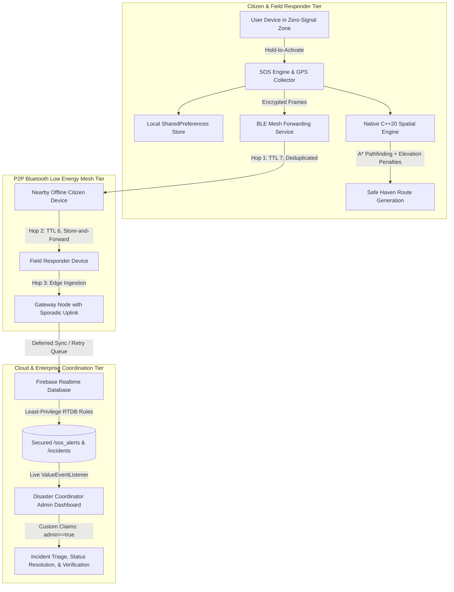

# GeoRescuX

<p align="center">
  
</p>

<p align="center">
  <strong>Autonomous Offline-First Disaster Emergency Response, Resilient P2P BLE Mesh, & High-Performance C++20 Spatial Engine</strong>
</p>

<p align="center">
  <a href="https://github.com/Sanidhyanegi07/GeoRescuX"></a>
  <a href="https://github.com/Sanidhyanegi07/GeoRescuX"></a>
  <a href="https://github.com/Sanidhyanegi07/GeoRescuX"></a>
  <a href="https://github.com/Sanidhyanegi07/GeoRescuX"></a>
  <a href="https://github.com/Sanidhyanegi07/GeoRescuX"></a>
  <a href="https://github.com/Sanidhyanegi07/GeoRescuX"></a>
  <a href="LICENSE"></a>
</p>

---

## 📌 Executive Summary

**GeoRescuX** is a mission-critical, offline-first disaster response and emergency routing platform built for the **Smart India Hackathon 2026** (Problem Statement **SIH26206**, Disaster Management Software Track).

In catastrophic events—such as Himalayan flash floods, cloudbursts, severe earthquakes, and structural collapses—conventional cloud-reliant emergency systems fail immediately due to base transceiver station (BTS) outages, power loss, and fiber severances. **GeoRescuX operates autonomously without cellular or internet connectivity**, providing peer-to-peer survival networking, native topological route generation, and guaranteed data delivery.

> *"The emergency system designed to work when every other system stops working."*

---

## 🏛️ System Architecture



---

## ⚡ Core Engineering Pillars

### 1. 🚀 40% Native C++20 Spatial Engine (`app/src/main/cpp/`)
The routing and telemetry subsystem is implemented directly in modern C++20 and compiled via the Android NDK for near-instantaneous execution:
- **A\* Pathfinding (`routing/RouteGraph.cpp`)**: High-performance shortest-path search over partitioned OpenStreetMap (OSM) regional topological graphs with admissible Haversine heuristics.
- **3D Elevation Cost Model (`spatial/ElevationCostModel.cpp`)**: Dynamically penalizes steep climbs, terrain fatigue, and high-altitude hypoxia risks during evacuation.
- **Cryptographic Packet Authenticator (`crypto/PacketAuthenticator.cpp`)**: Enforces HMAC-SHA256 signature verification and sliding-window timestamp replay protection for over-the-air BLE emergency packets.
- **Dynamic Spatial Hazard Containment (`spatial/HazardPolygon.cpp`)**: Ray-casting point-in-polygon intersection to automatically avoid active landslides, flash flood corridors, and blocked roads.
- **Zero-Copy JNI Bridges (`jni/GeoRescueNativeRoutingBridge.cpp`)**: High-throughput memory-safe JNI bridging with automatic fallback to pure Kotlin if native binary loading is unavailable.

### 2. 📡 Peer-to-Peer Multi-Hop BLE Mesh (`app/src/main/kotlin/.../ble/`)
When infrastructure goes dark, GeoRescuX forms a spontaneous, self-healing ad-hoc mesh network:
- **Symmetric GATT Architecture**: Each device simultaneously operates as a BLE Central (Scanner) and Peripheral (Advertiser).
- **Store-and-Forward Relay**: Emergency SOS packets travel up to 7 hops across intermediary devices with local duplicate packet caches (LRU) to eliminate broadcast storms.
- **Opportunistic Gateway Uplink**: The instant any device in the mesh reconnects to cellular data or satellite uplink, it automatically pushes buffered emergency records to Firebase.

### 3. 🛡️ Enterprise Least-Privilege Security Rules (`database.rules.json`)
The Firebase Realtime Database security model enforces strict zero-trust constraints validated by a **39-case automated emulator test suite**:
- **Owner Lifecycle Isolation**: Normal users can only create and update their own SOS records (`ACTIVE` $\rightarrow$ `COMPLETED`). They cannot modify coordinates once submitted, reopen completed alerts, or delete emergency traces.
- **Admin Least Privilege**: Administrators authenticated via verified Firebase Custom Claims (`auth.token.admin == true`) can update SOS records only to `RESOLVED`. Admins are strictly prohibited from altering victim GPS telemetry or situation notes.
- **Metadata Protection**: Identity verification status (`isVerified`) and internal incident logs (`/incidents`, `/events`) can only be modified by authorized emergency coordinators.

### 4. 🗺️ Partitioned Offline Regional Graphs (`output/`)
Rather than relying on unwieldy multi-gigabyte nationwide datasets, GeoRescuX uses pre-processed, lightweight regional routing graphs:
- **Uttarakhand**: Comprehensive Himalayan topography, road networks, and verified relief havens.
- **Himachal Pradesh**: High-altitude road matrices, mountain passes, and medical centers.
- **Haryana & Uttar Pradesh**: Plains evacuation corridors and emergency hubs.
- **Sample Region**: Connaught Place / Delhi NCT benchmark validation dataset.

---

## 📱 Dual-Role Application Experience

| Citizen Mobile App | Administrative Command Console |
| :---: | :---: |
|  |  |
| **Emergency SOS Activation, Safe Route Navigation, Regional Offline Maps, & P2P Mesh Status** | **Live SOS Incident Map, Heuristic Priority Ranking, Verification Approval, & Hazard Broadcast** |

### Citizen Mobile Frontend
- **1-Second Hold SOS**: Rapid physical activation trigger with vibration feedback and countdown cancellation.
- **Offline Safe Route**: Dijkstra/A* evacuation guidance directing victims away from verified hazards toward safe shelters.
- **Identity Verification**: In-app document submission granting prioritized rescue dispatch weightings.
- **Emergency Contacts**: Local-first ICE (In Case of Emergency) address book synced peer-to-peer.

### Admin Command Portal (`AdminDashboardActivity.kt`)
- **Heuristic Priority Scoring (`EmergencyPriorityCalculator.kt`)**: Prioritizes emergency queues based on verified identity status, elapsed duration, and regional danger density.
- **Operational Management**: Dynamic insertion of road blocks, avalanche zones, and regional emergency broadcasts.
- **Status Triage**: Server-verified resolution marking (`RESOLVED`) ensuring end-to-end accountability.

---

## 📊 Repository Technology Breakdown

Verified via live GitHub Linguist language metrics:

| Technology | Purpose | Share |
| :--- | :--- | :--- |
| **C++ (C++20)** | Native A\* Routing, Elevation Cost Model, Packet Auth, Drogon Simulators | **40.09%** |
| **Kotlin (2.2)** | Android UI, ViewModels, BLE Mesh Foreground Service, Sync Repositories | **53.25%** |
| **Java** | High-performance low-level Android SDK integration | **5.83%** |
| **CMake & Tooling** | Multi-ABI NDK compilation (`arm64-v8a`, `armeabi-v7a`, `x86`, `x86_64`) | **0.83%** |

---

## 🛠️ Build and Installation

### Prerequisites
- Android Studio Iguana / Ladybug or newer
- Android SDK 34 (`minSdk 24`, `targetSdk 34`)
- Android NDK 26+ (`26.1.10909125`)
- CMake 3.22.1+
- JDK 17 / Java 21

### 1. Clone the Repository
```bash
git clone https://github.com/Sanidhyanegi07/GeoRescuX.git
cd GeoRescuX
```

### 2. Compile Native Binaries & Build Debug APK
```bash
# Builds native C++20 libraries across all ABIs and packages the APK
./gradlew assembleDebug
```
The compiled APK will be generated at:
`app/build/outputs/apk/debug/app-debug.apk`

### 3. Run Android Unit Test Suite
```bash
./gradlew testDebugUnitTest
```

### 4. Execute Firebase Security Rules Matrix (Local Emulator)
```bash
# Executes 39 verified rule assertions against real Firebase RTDB Emulator
firebase emulators:exec --project demo-georescux "node app/src/test/resources/run_emulator_rules_tests.js" --only database
```

---

## 📂 Repository Layout

```text
GeoRescuX/
├── app/
│   ├── src/
│   │   ├── main/
│   │   │   ├── cpp/                 # Native C++20 Core
│   │   │   │   ├── crypto/          # HMAC-SHA256 packet authenticator
│   │   │   │   ├── jni/             # JNI zero-copy routing bridges
│   │   │   │   ├── routing/         # A* pathfinder & graph models
│   │   │   │   └── spatial/         # Elevation cost & hazard containment
│   │   │   ├── java/.../georescux/  # Kotlin Application Sources
│   │   │   │   ├── ble/             # Multi-hop BLE mesh subsystem
│   │   │   │   ├── data/            # Local-first stores & sync repositories
│   │   │   │   ├── domain/          # Priority calculator & incident triage
│   │   │   │   └── ui/              # User and Admin UI controllers
│   │   │   ├── res/                 # Material XML layouts, drawables, & icons
│   │   │   └── AndroidManifest.xml  # Service & permission declarations
│   │   └── test/                    # Unit tests & emulator rule test suites
│   ├── build.gradle.kts             # AGP 8.13, NDK, and CMake configuration
│   └── google-services.json         # Firebase project configuration
├── prototype_qt/                    # Cross-platform C++20 / Qt 6.11.1 native prototype
├── backend/                         # Standalone C++20 Drogon server & simulators
├── functions/                       # Firebase Cloud Functions custom claim gatekeeper
├── georescux-admin-provision/       # Node.js Firebase Admin SDK claim provisioner
├── docs/                            # Deep architectural, security, and testing documentation
│   ├── audit/                       # Baseline inventory, final audit report, limitations
│   ├── architecture/                # Four pillars of OOP, class reference, repository guide
│   ├── testing/                     # Test execution logs, master APK hashes, build verification
│   ├── security/                    # Security review, least-privilege rules, custom claims
│   └── development/                 # Reproducible developer setup & toolchain guides
├── output/                          # Bundled regional routing graphs & manifests
├── ARCHITECTURE.md                  # Master enterprise architecture & design invariants
├── database.rules.json              # 39-case verified least-privilege security rules
├── firebase.json                    # Firebase emulator & database configuration
└── README.md                        # Master documentation
```

---

## 📚 Master Engineering Documentation Library

Exhaustive, verified technical specifications and audit reports are available in the repository:

- 🏛️ **[Enterprise Architecture Specification](ARCHITECTURE.md)**: Master blueprint detailing subsystem layers, design invariants, C++20 native engine contracts, and full directory justification.
- 🔐 **[Admin Provisioning Subsystem](georescux-admin-provision/README.md)**: Command-line provisioning utility utilizing Firebase Admin SDK to mint cryptographic coordinator claims.
- ⚡ **[Cloud Functions Backend Gatekeeper](functions/README.md)**: Serverless custom claims automation with strict administrative gatekeeping.
- 📐 **[System Architecture](docs/architecture/SYSTEM_ARCHITECTURE.md)**: Deep dive into the multi-tier layered model, threading, and dual-mesh topology.
- 📂 **[Repository & Module Guide](docs/architecture/REPOSITORY_GUIDE.md)**: Comprehensive folder-by-folder and file-by-file inventory.
- 🧱 **[Four Pillars of OOP](docs/architecture/OOP_FOUR_PILLARS.md)**: Real-world encapsulation, inheritance, polymorphism, and abstraction with exact source lines.
- 📑 **[Master Class Reference](docs/architecture/CLASS_REFERENCE.md)**: Index of critical Kotlin, C++, and Qt classes, contracts, and responsibilities.
- 🛡️ **[Security & Access Control Review](docs/security/SECURITY_REVIEW.md)**: Custom claims, zero-trust role resolution, and vulnerability analysis.
- 🔍 **[Final Audit Report](docs/audit/FINAL_AUDIT_REPORT.md)**: Code review findings, resolved UI/UX defects, and defect registers.
- ⚙️ **[Build & Setup Guide](docs/development/BUILD_AND_SETUP.md)**: Step-by-step reproducible toolchain and compilation instructions.
- 🧪 **[Test & Build Report](docs/testing/TEST_AND_BUILD_REPORT.md)**: JVM unit tests, Qt desktop CTests, and release APK cryptographic hashes.
- ⚠️ **[Known Limitations](docs/audit/KNOWN_LIMITATIONS.md)**: Transparent boundary definitions for physical RF, satellite GNSS, and cloud deployments.
- 🎓 **[Viva Preparation Guide](docs/engineering/VIVA_PREPARATION.md)**: Complete interview and oral defense guide with elevator pitch and diagrams.

---

## 👥 Smart India Hackathon 2026 Team

**Problem Statement SIH26206**: Disaster Management (Software Track)

- **Sanidhya Negi** — System Architect & Lead Engineer
- **Tushar** — Mobile & BLE Mesh Specialist
- **Rudraksh** — Geospatial & Native Routing Engineer
- **Nehal** — Frontend & UI/UX Architect
- **Dheeraj** — Backend & Simulation Engineer
- **Nirmay** — QA & Security Systems Auditor

---

## 📄 License

This project is licensed under the [MIT License](LICENSE).
GeoRescuX — *Resilience when infrastructure fails.*
