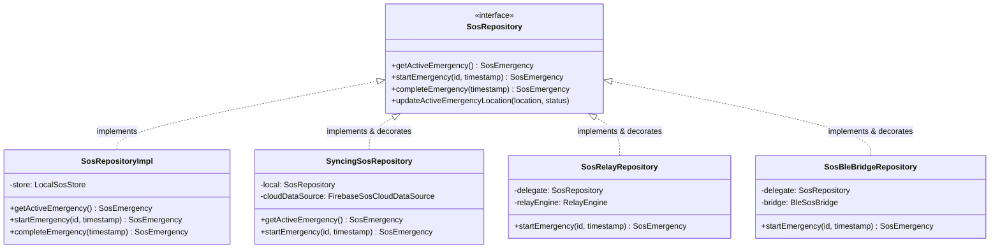

# GeoRescuX — The Four Pillars of Object-Oriented Programming (OOP)

## 1. Executive Summary

Object-Oriented Programming (OOP) in GeoRescuX enforces life-safety guarantees, modular testing, and decoupled architecture across both the **Kotlin Android Production Application** and the **C++20 / Qt 6.11.1 Prototype**:
- **Encapsulation** protects critical distress states, preventing corrupted coordinates or unauthorized state mutations.
- **Inheritance** binds GeoRescuX safely into Android OS lifecycle and Qt Quick rendering frameworks.
- **Polymorphism** enables dynamic runtime substitution between local storage, Bluetooth Low Energy mesh transports, and Firebase cloud synchronization.
- **Abstraction** isolates volatile hardware, radio, and networking details behind stable domain interfaces.

---

## 2. Master OOP Evidence & Verification Matrix

| Pillar | Application | Class / Interface | Exact File Path | Relevant Method(s) | Actual Evidence | Benefit | Improvement Opportunity |
| :--- | :--- | :--- | :--- | :--- | :--- | :--- | :--- |
| **Encapsulation** | Kotlin Android | `SosRepositoryImpl` | [`app/src/main/kotlin/.../SosRepositoryImpl.kt`](file:///c:/Users/sanid/Documents/GitHub/GeoRescuX/app/src/main/kotlin/com/example/georescux/data/sos/SosRepositoryImpl.kt) | `startEmergency()`, `completeEmergency()`, `updateActiveEmergencyLocation()` (L13–48) | `private val store: LocalSosStore`, `if (store.loadActive() != null) return null`, `val resolved = location ?: active.location` | Enforces single-active SOS invariant; prevents null GPS readings from overwriting valid fixes. | Add thread-safe Mutex or StateFlow for concurrent updates across multiple BLE threads. |
| **Encapsulation** | C++20 / Qt | `EmergencyService` | [`prototype_qt/src/domain/EmergencyService.h`](file:///c:/Users/sanid/Documents/GitHub/GeoRescuX/prototype_qt/src/domain/EmergencyService.h) | `activateEmergency()`, `completeEmergency()` (L31–100) | `private: std::shared_ptr<IEmergencyRepository> m_repository; std::optional<EmergencyRecord> m_activeRecord;` | Prevents QML views from mutating active distress states without prior database write confirmation. | Introduce read-only immutable value object return types for Q_PROPERTY getters. |
| **Inheritance** | Kotlin Android | `GeoRescuXApplication` | [`app/src/main/kotlin/.../GeoRescuXApplication.kt`](file:///c:/Users/sanid/Documents/GitHub/GeoRescuX/app/src/main/kotlin/com/example/georescux/GeoRescuXApplication.kt) | `onCreate()`, `onTerminate()` (L353–407) | `class GeoRescuXApplication : Application()`, `super.onCreate()` | Hooks into Android OS process creation to initialize background sync before UI launch. | Prefer composition over framework inheritance wherever Android framework permits. |
| **Inheritance** | C++20 / Qt | `SqliteEmergencyRepository` | [`prototype_qt/src/platform/storage/SqliteEmergencyRepository.h`](file:///c:/Users/sanid/Documents/GitHub/GeoRescuX/prototype_qt/src/platform/storage/SqliteEmergencyRepository.h) | `: public IEmergencyRepository` (L14–45) | `class SqliteEmergencyRepository : public IEmergencyRepository`, virtual destructor, `override` specifier | Inherits interface contract while enabling complete isolation of SQLite transactional code. | Consider CRTP (Curiously Recurring Template Pattern) for static compile-time polymorphism if vtable overhead becomes an issue. |
| **Polymorphism** | Kotlin Android | `SosRelayRepository` | [`app/src/main/kotlin/.../SosRelayRepository.kt`](file:///c:/Users/sanid/Documents/GitHub/GeoRescuX/app/src/main/kotlin/com/example/georescux/data/sos/SosRelayRepository.kt) | `startEmergency()`, `completeEmergency()` (L12–50) | `class SosRelayRepository(private val delegate: SosRepository, ...): SosRepository` | Decorator pattern dynamically forwards emergency start to Google Nearby mesh at runtime. | Standardize exception bubbling across decorator chains using a unified `Result<T>` wrapper. |
| **Polymorphism** | C++20 / Qt | `ILocationProvider` | [`prototype_qt/src/domain/ILocationProvider.h`](file:///c:/Users/sanid/Documents/GitHub/GeoRescuX/prototype_qt/src/domain/ILocationProvider.h) | `startUpdates()`, `stopUpdates()` (L13–28) | Dynamic dispatch via vtable to either `QtLocationProvider` (GPS) or `FakeLocationProvider` (simulated). | Allows unit test suites (`tst_location.cpp`) to test complex trajectories without physical satellites. | Add `std::expected` or `std::error_code` return types to `startUpdates()`. |
| **Abstraction** | Kotlin Android | `RouteRepository` | [`app/src/main/kotlin/.../RouteRepository.kt`](file:///c:/Users/sanid/Documents/GitHub/GeoRescuX/app/src/main/kotlin/com/example/georescux/domain/repository/RouteRepository.kt) | `findRoute()`, `setRoadBlocked()` (L10–25) | `interface RouteRepository`, implemented by `RouteRepositoryImpl` | Completely decouples UI activities from OSM graph parsing, KD-Tree indices, and C++ JNI calls. | Add coroutine `suspend` keyword directly to `findRoute` to enforce non-blocking execution at the interface level. |
| **Abstraction** | C++20 / Qt | `IEmergencyRepository` | [`prototype_qt/src/domain/IEmergencyRepository.h`](file:///c:/Users/sanid/Documents/GitHub/GeoRescuX/prototype_qt/src/domain/IEmergencyRepository.h) | `getActiveEmergency()`, `activateEmergency()` (L16–73) | Pure abstract base class with pure virtual functions (`= 0`) and virtual destructor | Decouples domain orchestration from SQLite queries, column indexes, and database locks. | Ensure consistent use of `std::string_view` or `QStringView` for string parameters to reduce allocations. |

---

## 3. The Four Pillars: Detailed Implementation Analysis

### A. Encapsulation

#### Concept
Encapsulation guarantees that an object's internal representation is hidden from the outside. Only the object's own methods can directly inspect or manipulate its fields, protecting invariants and preventing invalid states.

#### Kotlin Example: `SosRepositoryImpl`
In [`app/src/main/kotlin/com/example/georescux/data/sos/SosRepositoryImpl.kt`](file:///c:/Users/sanid/Documents/GitHub/GeoRescuX/app/src/main/kotlin/com/example/georescux/data/sos/SosRepositoryImpl.kt#L13-L48):
- `private val store: LocalSosStore`: The persistent storage mechanism is completely private. External callers cannot directly insert, delete, or corrupt records.
- Invariant: A citizen can only have **one** active emergency at a time. This rule is enforced inside `startEmergency()`:
  ```kotlin
  if (store.loadActive() != null) return null
  ```
- Coordinate Protection: When updating location, if the GPS fix is momentarily lost (null), the previous valid coordinates are preserved:
  ```kotlin
  val resolvedLocation = location ?: active.location
  ```

#### C++ Example: `EmergencyService`
In [`prototype_qt/src/domain/EmergencyService.h`](file:///c:/Users/sanid/Documents/GitHub/GeoRescuX/prototype_qt/src/domain/EmergencyService.h#L97-L99):
- `m_repository`, `m_activeRecord`, and `m_lastError` are strictly `private`.
- The member function `activateEmergency` enforces that an active emergency cannot be overwritten if one is already in progress:
  ```cpp
  if (m_activeRecord.has_value()) {
      m_lastError = QStringLiteral("An emergency is already active.");
      return false;
  }
  ```

---

### B. Inheritance

#### Concept
Inheritance allows a new class to inherit attributes and methods from an existing class, establishing an *"is-a"* relationship and facilitating controlled specialization.

#### Kotlin Example: Framework Extension in `GeoRescuXApplication`
In [`app/src/main/kotlin/com/example/georescux/GeoRescuXApplication.kt`](file:///c:/Users/sanid/Documents/GitHub/GeoRescuX/app/src/main/kotlin/com/example/georescux/GeoRescuXApplication.kt#L353-L407):
- `GeoRescuXApplication` inherits from `android.app.Application`.
- It overrides Android framework lifecycle hooks (`onCreate()` and `onTerminate()`), invoking `super.onCreate()` to preserve operating system initializations while injecting GeoRescuX's background worker initializations.

#### C++ Example: Interface Inheritance in `SqliteEmergencyRepository`
In [`prototype_qt/src/platform/storage/SqliteEmergencyRepository.h`](file:///c:/Users/sanid/Documents/GitHub/GeoRescuX/prototype_qt/src/platform/storage/SqliteEmergencyRepository.h#L14-L45):
- `class SqliteEmergencyRepository : public IEmergencyRepository`: Derives from the abstract base class and implements every pure virtual method (`= 0`) using the `override` specifier.

---

### C. Polymorphism

#### Concept
Polymorphism allows different underlying classes to be accessed through the same unified interface. At runtime, calls to interface methods are dynamically dispatched to the specific concrete implementation.

#### Kotlin Example: Decorator Chain in `AppContainer`
In [`app/src/main/kotlin/com/example/georescux/GeoRescuXApplication.kt`](file:///c:/Users/sanid/Documents/GitHub/GeoRescuX/app/src/main/kotlin/com/example/georescux/GeoRescuXApplication.kt#L92-L264):
```kotlin
val localSosRepository: SosRepository = SosRepositoryImpl(sosStore)
val syncingSosRepository: SyncingSosRepository = SyncingSosRepository(localSosRepository, ...)
val sosRelayRepository: SosRepository = SosRelayRepository(syncingSosRepository, ...)
val sosBleBridgeRepository: SosRepository = SosBleBridgeRepository(sosRelayRepository, ...)
val sosRepository: SosRepository = sosBleBridgeRepository
```
When `SosViewModel` invokes `sosRepository.startEmergency(...)`:
1. Dispatches polymorphically to `SosBleBridgeRepository` (triggers BLE GATT broadcast).
2. Dispatches to `SosRelayRepository` (broadcasts over Google Nearby mesh).
3. Dispatches to `SyncingSosRepository` (queues pending cloud sync).
4. Dispatches to `SosRepositoryImpl` (writes atomically to disk).

#### C++ Example: Virtual Method Table (vtable) Dispatch in `LocationService`
In [`prototype_qt/src/domain/LocationService.cpp`](file:///c:/Users/sanid/Documents/GitHub/GeoRescuX/prototype_qt/src/domain/LocationService.cpp#L25):
- `m_provider->startUpdates(highFrequency)` resolves at runtime through the vtable to either `QtLocationProvider` (on Android with GPS) or `FakeLocationProvider` (in unit tests).

---

### D. Abstraction

#### Concept
Abstraction hides complex background implementation details and exposes only the essential operations to the client.

#### Kotlin Example: `RouteRepository`
In [`app/src/main/kotlin/com/example/georescux/domain/repository/RouteRepository.kt`](file:///c:/Users/sanid/Documents/GitHub/GeoRescuX/app/src/main/kotlin/com/example/georescux/domain/repository/RouteRepository.kt#L10-L25):
- Exposes `findRoute(startId, destinationId): EvacuationRoute?`.
- Completely abstracts away whether the graph is decoded from OpenStreetMap PBF, whether routing runs via C++ JNI (`GeoRescueNativeRouting`) or Kotlin A\* (`SafeHavenFallback`), and whether road blockages are stored in memory or SharedPreferences.

---

## 4. Architectural Class Relationships (UML Diagram)



---

## 5. SOLID Principles Evaluation

| Principle | Adherence Status | Evidence & Architectural Analysis |
| :--- | :---: | :--- |
| **Single Responsibility (SRP)** | **FOLLOWED** | `SosRepositoryImpl` only handles local persistence; `BleSosBridge` only handles packet formatting; `SyncRetryCoordinator` only handles network-triggered retries. |
| **Open / Closed (OCP)** | **FOLLOWED** | The SOS repository system is open for extension via Decorators (`SosBleBridgeRepository`, `SosRelayRepository`) without modifying `SosRepositoryImpl`. |
| **Liskov Substitution (LSP)** | **FOLLOWED** | Any implementation of `ILocationProvider` (`QtLocationProvider` or `FakeLocationProvider`) can be substituted in `LocationService` without altering caller behavior. |
| **Interface Segregation (ISP)** | **FOLLOWED** | `ContactsBackup` and `SosBackup` interfaces are segregated from their respective repositories so `SyncRetryCoordinator` depends only on sync contracts. |
| **Dependency Inversion (DIP)** | **FOLLOWED** | High-level use cases (`StartSosUseCase`, `ReportHazardUseCase`) depend strictly on domain interfaces (`SosRepository`, `RelayEngine`), never on concrete SQLite or Firebase classes. |
