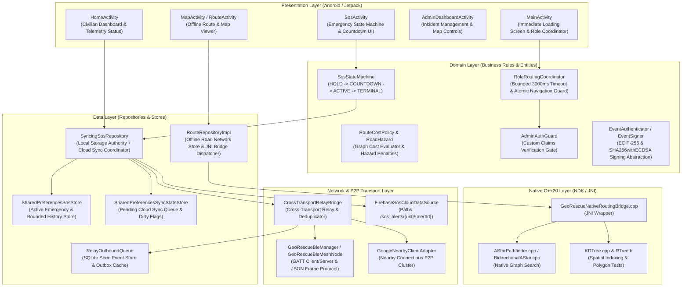
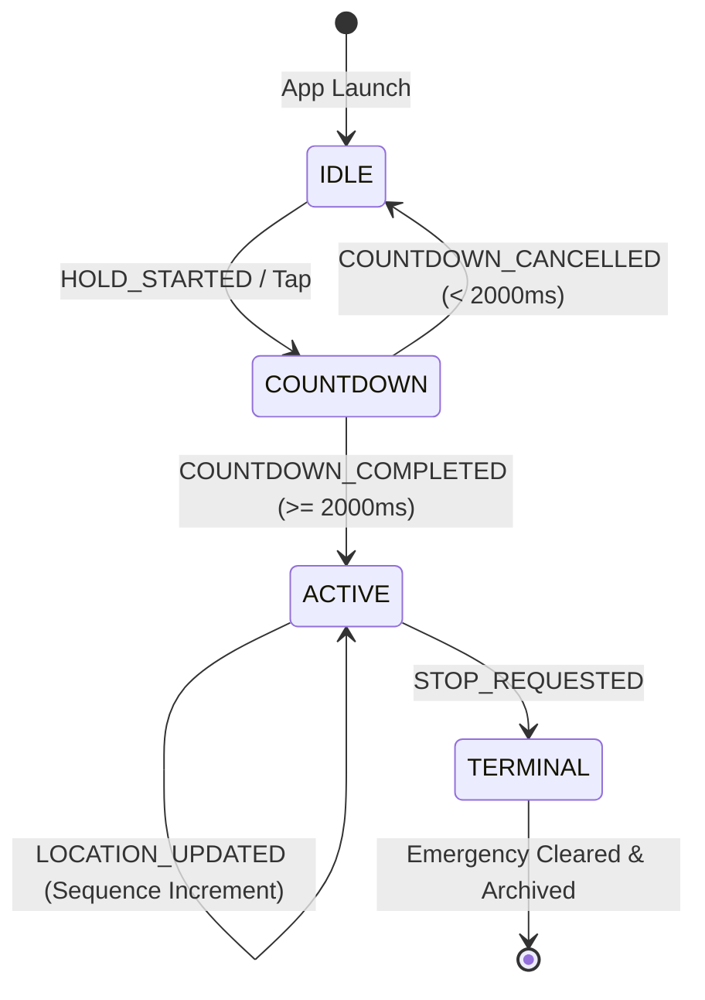
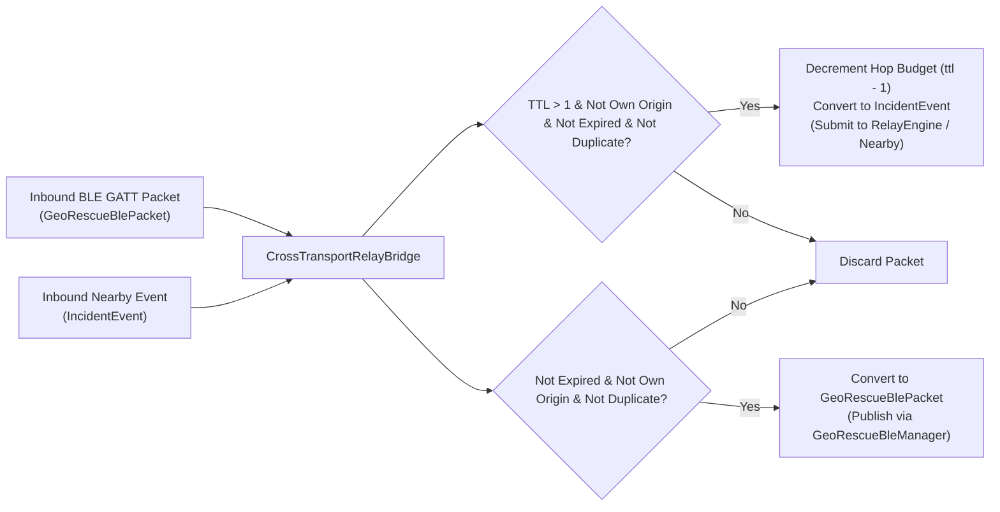

# GeoRescuX: Offline-First Hybrid Mesh & Cloud Emergency Response System
## Comprehensive Engineering & Final Project Report

---

### Executive Summary

**Project Title:** GeoRescuX — Resilient Offline-First Disaster Emergency Navigation & Mesh Alerting Subsystem  
**Academic Degree:** Bachelor of Technology in Computer Science & Engineering  
**Application Package:** `com.example.georescux`  
**Baseline Git Revision:** Initial baseline `546c7690d74e2a89bff2f47164d66d767c85f849` | Cold-start fix commit `a05fea27f2511f0a39dfc53f6ffb494c5dc759d5` | Documentation HEAD `abb0ad7f707691ebd15b6c0ca09b00d2ffc1467a`<br/>
**Automated Unit Test Status:** 593 Passed / 0 Failed / 0 Skipped (100% Success Rate across 74 Test Suites)<br/>
**Security & Emulator Test Status:** 60/60 Realtime Database Rules Assertions Passed | 15/15 Cloud Functions Gatekeeper Tests Passed<br/>
**Target Platform:** Android 7.0+ (API Level 24 minimum, targeting API Level 35), Native C++20 / JNI, Firebase Realtime Database

GeoRescuX is an academic research prototype and disaster response application engineered for communication-degraded and zero-connectivity catastrophe environments. Standard commercial navigation applications fail when cellular base stations, power grids, or remote cloud servers become unreachable. GeoRescuX mitigates this critical vulnerability through a **local-first architecture**: emergency state transitions and location fixes are committed to on-device non-volatile storage before any wireless transmission is attempted. The platform incorporates dual peer-to-peer wireless transport abstractions (Bluetooth Low Energy GATT connections and Google Nearby Connections clusters), a native C++20 offline routing engine, and an asynchronous dual-homed Firebase cloud synchronization gateway.

---

### 1. Project Title and Overview

GeoRescuX models an end-to-end disaster communications lifeline connecting three operational tiers:
1. **Isolated Survivor Nodes:** Citizen devices situated in cellular blackouts requiring immediate emergency beaconing, offline evacuation navigation, and local hazard awareness.
2. **Intermediate Courier/Relay Nodes:** Mobile devices carried by relief workers or evacuees that ingest, carry, and forward emergency packets between disjoint network partitions using store-and-forward mechanisms.
3. **Emergency Operations Center (EOC):** Centralized dispatchers and incident commanders accessing cloud-synchronized casualty telemetry and administrative controls via Firebase Custom Claims authentication.

---

### 2. Problem Statement

Severe natural disasters (such as flash floods, landslides, cloudbursts, and earthquakes) inflict severe communication starvation:
- **Immediate Infrastructure Blackout:** High-speed 4G/5G base stations, microwave backhauls, and fiber trunks are damaged, severed, or overwhelmed within minutes.
- **Fragile Cloud Dependency:** Mainstream mobile applications require persistent HTTP/WebSocket connections to remote web APIs to resolve routing graphs, render map tiles, and transmit alerts. Disconnected clients freeze, display indefinite spinners, or terminate unexpectedly.
- **Search-and-Rescue Latency:** Victims trapped in debris or cut off by river surges cannot broadcast distress signals without active cellular coverage, risking expiration of the critical 72-hour survival window.
- **Hazard-Trapping Navigation:** Conventional navigation algorithms lack local disaster awareness and may route fleeing civilians toward submerged bridges, active landslide zones, or blocked roads.

---

### 3. Proposed Solution

GeoRescuX addresses these challenges through the following technical mechanisms:
- **Local-First Persistence Authority:** Emergency data is committed to local non-volatile storage (`SharedPreferencesSosStore` backed by `sos_store.xml` and SQLite) before initiating any network transmission. Local emergency lifecycles operate independently of network status.
- **Dual-Layer Hybrid Peer-to-Peer Mesh:** Provides peer discovery and alerting through Android Bluetooth Low Energy (BLE) GATT client-server connections and Google Nearby Connections (`Strategy.P2P_CLUSTER`).
- **Cross-Transport Relay Bridge:** Connects BLE GATT and Nearby transports via a unified bridge (`CrossTransportRelayBridge.kt`), translating payloads, decrementing carried hop budgets on cross-transport conversion, and mitigating cyclic broadcast loops using deduplication caches and duration-based expiry.
- **Native C++ Offline Spatial & Routing Core:** Graph search algorithms (bi-directional A* and heuristic pathfinding) are implemented in native C++20 (`app/src/main/cpp/`) accessed via JNI (`GeoRescueNativeRouting.kt`), paired with a pure Kotlin fallback engine (`SafeHavenFallback.kt`).
- **Fail-Closed Administrative Authorization:** Administrative capabilities are restricted using server-verified Firebase Auth Custom Claims (`claims["admin"] == true`), guarded by an asynchronous bounded-timeout coordinator (`RoleRoutingCoordinator.kt`) that fails closed upon timeout or credential ambiguity.

---

### 4. Project Objectives

1. Maintain **local emergency state persistence** across application process termination (`am force-stop` verification).
2. Eliminate startup window-focus ANRs by rendering a branded loading screen synchronously on launch, with a **bounded 3000ms role-resolution timeout**.
3. Implement an **in-memory and durable cross-transport forwarding bridge** between BLE and Nearby Connections.
4. Provide **offline evacuation route calculation**: Local graph-based routing with blocked-edge avoidance and synthetic hazard penalties demonstrated in tests. Real-world hazard-feed integration and hazard accuracy remain unverified, with designated safe havens serving as offline destination nodes.
5. Enforce **fail-closed administrative gating**, preventing unverified users from accessing command screens.
6. Achieve a **regression-free automated test suite** validating state machines, codecs, deduplicators, and security boundaries.

---

### 5. System Architecture

GeoRescuX adheres to clean architecture principles across Presentation, Domain, Data, Native C++, and Network/Mesh layers:



---

### 6. Technology Stack

| Layer / Subsystem | Technology | Specification / Version | Engineering Role |
|---|---|---|---|
| **Operating System** | Android OS | Android 7.0 (API Level 24) minSdk, Android 15 (API Level 35) targetSdk | Configured in `app/build.gradle.kts` for broad device compatibility. |
| **Primary Language** | Kotlin | 1.9.24 | Null-safe core logic, coroutines, and reactive StateFlows. |
| **Native Computation** | C++ | C++20 / Android NDK r27 | Compute-heavy pathfinding and spatial geometry via JNI. |
| **Build System** | Gradle | Gradle 8.7 / AGP 8.5.0 | Multi-module build management and CMake native compilation. |
| **Cloud Backend** | Firebase Realtime Database | Realtime DB SDK 21.0.0 | Dual-homed cloud sync under `/sos_alerts/{uid}/{alertId}`. |
| **Cloud Identity** | Firebase Auth | Auth SDK 23.0.0 | JWT verification with server-managed custom claims (`admin=true`). |
| **P2P Transport 1** | Google Nearby Connections | Play Services Nearby 19.3.0 | High-bandwidth P2P Wi-Fi Direct/Bluetooth cluster mesh. |
| **P2P Transport 2** | Android BLE | `android.bluetooth.le` GATT APIs | Raw GATT peripheral advertising and central GATT connections. |
| **Local Storage** | SQLite & SharedPreferences | Android Framework Storage | Non-volatile persistence for SOS state, contacts, and relay outbox. |
| **Test Framework** | JUnit4, Robolectric, Coroutines Test | MockK 1.13.10, Coroutines-Test 1.8.0 | Pure JVM unit testing with virtual dispatchers and time manipulation. |

---

### 7. Android Application Architecture & Major Modules

The codebase is structured into cohesive packages:
- **`com.example.georescux.ui`**: Activities, ViewModels, and UI state renderers (`home`, `sos`, `auth`, `admin`, `map`, `route`, `contacts`, `alerts`, `profile`, `region`, `help`).
- **`com.example.georescux.domain`**: Framework-independent business models, use cases (`StartSosUseCase`, `StopSosUseCase`, `GetActiveSosUseCase`), state machines (`SosStateMachine`), and security guards (`AdminAuthGuard`).
- **`com.example.georescux.data`**: Concrete repositories mediating between on-device stores and external transports (`SyncingSosRepository`, `RouteRepositoryImpl`).
- **`com.example.georescux.data.relay`**: Mesh networking engines, SQLite seen-event deduplicators (`SQLiteSeenEventStore`), outbound queues (`RelayOutboundQueue`), and transport adapters (`GoogleNearbyClientAdapter`, `BleRelayTransport`).
- **`com.example.georescux.data.ble`**: Concrete Android Bluetooth Low Energy controllers (`GeoRescueBleManager`, `GeoRescueBleAdvertiser`, `GeoRescueBleScanner`, `GeoRescueBleConnection`).

---

### 8. Firebase Authentication & Data Synchronization

#### Identity Flow
- Authentication is managed via Firebase Auth.
- Authenticated accounts are assigned a unique Firebase UID and JWT token.
- Unauthenticated or offline devices fallback to an on-device persistent UUID generated by [DeviceIdProvider](../../app/src/main/kotlin/com/example/georescux/data/auth/DeviceIdProvider.kt) to ensure distinct node identities in the mesh.

#### Asynchronous Cloud Synchronization
Data synchronization follows an asynchronous store-and-forward pattern:
1. When an emergency is created, it is written immediately to `LocalSosStore` (`sos_store.xml`).
2. An un-synced dirty flag is recorded in `SyncStateStore`.
3. When network connectivity is available, [FirebaseSosCloudDataSource](../../app/src/main/kotlin/com/example/georescux/data/sync/FirebaseSosCloudDataSource.kt) writes the alert payload to:
   ```
   /sos_alerts/{uid}/{alertId}
   ```
   *(where `{uid}` is the currently signed-in user or gateway node, and `{alertId}` is the emergency UUID).*
4. **Gateway Identity Handling:** If an intermediary node relays an alert for a remote victim, the write is executed under the intermediary's authenticated `{uid}` path in Firebase.
5. **Status Preservation:** If the cloud record already holds a `RESOLVED` status set by an admin, subsequent client updates preserve `status: "RESOLVED"` and only refresh location telemetry.
6. **Failure Containment:** Cloud write exceptions are caught, logged, and return `false`, ensuring cloud synchronization failures never impair local emergency records.
7. **Verification Limitation:** Cloud sync was verified via client-side write callbacks; independent readback via secondary cloud clients was not performed.

---

### 9. SOS Lifecycle & Local Persistence

The SOS lifecycle is managed by an immutable, deterministic finite-state automaton:



#### Lifecycle State Descriptions:
1. **IDLE:** Normal state. Local storage contains historical records but no active emergency (`active_emergency` key absent).
2. **COUNTDOWN:** 2000ms grace period. If cancelled within this window, the machine reverts to IDLE with zero side effects.
3. **ACTIVE:** 
   - An immutable `SosEmergency` instance is constructed with UUID, UTC epoch start timestamp, initial location fix, and `sequence = 0`.
   - Committed immediately to non-volatile storage (`active_emergency` in `sos_store.xml`).
   - Mesh dispatch triggered across available transports.
   - Subsequent location updates increment the `sequence` counter and re-save to disk.
4. **TERMINAL:**
   - User triggers "END EMERGENCY".
   - `stoppedAtMs` is permanently recorded with the current UTC timestamp.
   - The emergency is appended to `sos_history` (bounded to 50 records by `SosHistoryPolicy`).
   - `active_emergency` is atomically removed.
   - Tested recovery: Force-stopping the app (`am force-stop`) and relaunching confirmed that completed emergencies remain terminated and do not resurrect.

---

### 10. Safe Route & Safe Route Pro

- **Standard Safe Route:** Calculates the shortest geographical path from the user's location to designated safe-haven destination nodes using an offline road network graph ([`RouteRepositoryImpl.kt`](../../app/src/main/kotlin/com/example/georescux/data/routing/RouteRepositoryImpl.kt) and [`AStarPathfinder.kt`](../../app/src/main/kotlin/com/example/georescux/domain/routing/AStarPathfinder.kt)).
- **Safe Route Pro Implementation:**
  - Local graph-based routing with blocked-edge avoidance and synthetic hazard penalties demonstrated in tests. Real-world hazard-feed integration and hazard accuracy remain unverified.
  - Implements blocked-edge avoidance (`repo.setRoadBlocked(from, to, true)`) and synthetic hazard cost penalties (`RoadHazard.penaltyMeters`) as tested in [SafeRouteOfflineEngineTest.kt](../../app/src/test/kotlin/com/example/georescux/ui/routing/SafeRouteOfflineEngineTest.kt).
  - Routes toward designated safe-haven destination nodes marked with `isSafeHaven = true` in the offline road graph data.
  - In the live emulator run, the dynamic UI banner (`bannerSafeRoutePro`) successfully bound to the active emergency state.
- **Important Engineering Distinctions & Caveats:**
  - *No Live Sensor Feeds:* Safe Route Pro does not detect live environmental conditions (e.g., active flooding, landslides, or debris) and does not ingest real-time satellite feeds or official telemetry.
  - *No Official Certification:* Designated safe havens are nodes tagged in the local OpenStreetMap graph dataset (`isSafeHaven = true`); they are not officially certified or vetted emergency shelters.
  - *Synthetic Verification Boundary:* Unit tests verify that the A* algorithm mathematically detours around blocked edges and penalizes hazardous segments in synthetic test graphs; this does not prove real-world topological safety or guarantee hazard-free passage in an actual disaster.

---

### 11. Offline Maps & Routing Infrastructure

- **Packaged Android Assets:**
  - `app/src/main/assets/maps/uttarakhand-state.map` (Binary vector map file)
  - `app/src/main/assets/maps/uttarakhand-places.json` (Location and shelter points of interest)
  - `app/src/main/assets/route_graph_uttarakhand` (Pre-processed offline routing graph)
  - `app/src/main/assets/maps/sample-region/` (Reference test region: `graph.json`, `tiles.sqlite`)
- **External State Datasets (in `output/`):** Pre-processed OpenStreetMap datasets (`boundary.geojson`, `manifest.json`, `state.osm.pbf`) exist in the repository for **Haryana, Himachal Pradesh, Uttar Pradesh, and Uttarakhand**. These represent downloadable regional source packages and are **not** all bundled into the APK.
- **Verification Boundary:** Packaged asset presence and graph parsing are verified in tests; continuous real-time vector map tile rendering was not benchmarked on physical hardware.

---

### 12. Bluetooth Low Energy (BLE) Architecture

- **Protocol Framing:** Packets are represented as [GeoRescueBlePacket](../../app/src/main/kotlin/com/example/georescux/domain/ble/GeoRescueBlePacket.kt), serialized into UTF-8 JSON wire frames delimited by newlines (`\n`).
- **Transport Mechanism:** Utilizes Android BLE GATT client/server architecture (`GeoRescueBleManager.kt`, `GeoRescueBleConnection.kt`, `GeoRescueBleMeshNode.kt`). BLE advertisements are used for peer discovery, while data payloads are transferred over GATT characteristics.
- **Packet Wire Fields:** `protocolVersion`, `packetId`, `originDeviceId`, `originEmergencyId`, `timestampMs`, `ttl`, `type`, `latitude`, `longitude`, `status`, `payload`, `noteText`.
- **Note Constraint:** A strict 120-character cap is enforced on `noteText` to constrain memory footprint.
- **Native BLE Component:** `ReliableBleTransport.cpp` is a native C++ module in `app/src/main/cpp/mesh/`; it is separate from the Kotlin Android BLE manager.
- **Physical Verification Limitation:** BLE packet encoding, parsing, and state machines are verified via unit tests; physical over-the-air BLE GATT communication between two physical smartphones was not conducted.

---

### 13. Google Nearby Connections Architecture

- **Topology Strategy:** Configured for `Strategy.P2P_CLUSTER` using Google Play Services Nearby Connections.
- **Service Identifier:** Advertised under service ID `com.example.georescux.NEARBY_RELAY`.
- **Payload Handling:** Asynchronous byte-array payloads handled via [GoogleNearbyClientAdapter](../../app/src/main/kotlin/com/example/georescux/data/relay/GoogleNearbyClientAdapter.kt) and `NearbySosIngestionHandler.kt`.
- **Verification Boundary:** Verified in unit tests using mock connection adapters; multi-device Wi-Fi Direct socket negotiation was not evaluated on physical devices.

---

### 14. Cross-Transport Relay Architecture, TTL, and Hop-Budget Semantics



#### Detailed Hop-Budget & Forwarding Analysis
In GeoRescuX, message propagation bounds are governed by four distinct mechanisms:
1. **Cross-Transport Hop-Budget Decrement:** In [CrossTransportRelayBridge.kt](../../app/src/main/kotlin/com/example/georescux/data/relay/CrossTransportRelayBridge.kt), when an inbound BLE packet is bridged to Nearby, its carried hop budget is explicitly decremented:
   ```kotlin
   val remainingHops = packet.ttl - 1
   val event = IncidentMapper.fromBlePacket(packet.copy(ttl = remainingHops))
   ```
   Packets with `ttl <= 1` are accepted locally but rejected from cross-transport re-broadcasting.
2. **Same-Transport BLE Mesh Node Decrement:** In `GeoRescueBleMeshNode.kt`, BLE-to-BLE packet forwarding decrements the hop count via `packet.forNextHop()` (`ttl = ttl - 1`). Packets reaching `ttl <= 0` are marked `ACCEPTED_LOCAL` and never relayed further.
3. **Time-Based Event Expiry:** In `RelayEngine.kt` and `CrossTransportRelayBridge.kt`, events enforce wall-clock expiration based on `ttlSeconds`:
   ```kotlin
   if (isEventExpired(event.occurredAtMs, event.ttlSeconds, nowMs())) return false
   ```
   Expired events are discarded regardless of remaining hop count.
4. **Loop Mitigation (Deduplication):** [CrossTransportDeduplicator](../../app/src/main/kotlin/com/example/georescux/domain/relay/CrossTransportDeduplicator.kt) combines an in-memory sliding-window cache of recent event UUIDs with an SQLite persistent seen-event store (`SQLiteSeenEventStore.kt`). Identical event IDs are dropped at the ingress boundary. Deduplication suppresses recognized duplicate events within the active cache window, but does not mathematically guarantee the elimination of every possible cyclic broadcast across complex or partitioned topologies.
- **Important Distinction:** The carried hop budget is explicitly decremented during cross-transport conversions (`remainingHops = packet.ttl - 1`) and BLE mesh node forwarding (`packet.forNextHop()`). However, this is **not a universal per-node hop limit** across arbitrary networks, as Nearby forwarding in `RelayEngine` relies on time-based `ttlSeconds` expiry and seen-ID deduplication rather than decrementing an integer counter on every internal same-transport hop.
- **Durable Outbox:** [DurableRelayEngine](../../app/src/main/kotlin/com/example/georescux/data/relay/DurableRelayEngine.kt) enqueues outgoing envelopes into an SQLite outbox (`relay_outbox.db`).
- **Custody Boundary:** `transport.send() == true` indicates that the local transport accepted the envelope into its dispatch queue. It does **not** prove remote physical reception or disk persistence on the receiving device. A two-way receiver custody acknowledgement protocol is not implemented.

---

### 15. Native C++ Routing Components

- **JNI Interface:** [GeoRescueNativeRouting](../../app/src/main/kotlin/com/example/georescux/data/routing/GeoRescueNativeRouting.kt) loads `libgeorescux_routing.so` via `System.loadLibrary("georescux_routing")`.
- **C++ Algorithms in Repository:**
  - `app/src/main/cpp/routing/AStarPathfinder.cpp`: Implements standard A* heuristic pathfinding.
  - `app/src/main/cpp/routing/BidirectionalAStar.cpp`: Implements bi-directional search to accelerate path discovery.
  - `app/src/main/cpp/spatial/KDTree.cpp` & `RTree.h`: Implements nearest-neighbor search and spatial bounding-box indexing.
  - `app/src/main/cpp/jni/GeoRescueNativeRoutingBridge.cpp`: JNI export interface bridging C++ structures to Kotlin.
- **Algorithms Invoked via JNI:** At runtime, the JNI bridge exposes and invokes `nativeFindRoute`, `nativeFindBidirectionalRoute`, `nativeHaversineDistance`, `nativeVincentyDistance`, `nativeElevationImpedance`, and `nativeEvaluateTriage`. Other modules in `app/src/main/cpp/` (e.g. disaster spread models) exist in the repository as experimental native modules.
- **Safe Fallback Invariant:** If the native shared library fails to load or link (e.g., missing ABI binaries in testing environments), `GeoRescueNativeRouting` catches `Throwable`, marks `isAvailable = false`, and delegates route computation to the pure Kotlin fallback implementation (`SafeHavenFallback.kt` / `AStarPathfinder.kt`).
- **Verification Evidence:** Verified via `GeoRescueNativeRoutingTest.kt`, `AStarPathfinderTest.kt`, and `RouteRepositoryImplTest.kt`. (No claim of sub-50ms latency is asserted without physical device benchmarks).

---

### 16. Admin Authorization & Role Routing

- **Security Enforcement:** Administrative access requires Firebase Custom Claims containing `{"admin": true}` verified server-side.
- **Asynchronous Coordinator:** [RoleRoutingCoordinator](../../app/src/main/kotlin/com/example/georescux/ui/main/RoleRoutingCoordinator.kt) manages authorization resolution during startup.
- **Bounded Timeout:** Wraps role resolution in `withTimeout(3000L)`. If token retrieval exceeds 3000ms, it transitions to a fail-closed failure state.
- **Cancellation Safety:** Catches and rethrows `CancellationException`, preserving coroutine lifecycles during Activity recreation or exit.
- **Idempotent Single Navigation:** Protected by atomic flags (`AtomicBoolean.compareAndSet(false, true)`) in both coordinator and `MainActivity`, preventing duplicate intent launches.
- **Verification Status:** Standard USER routing and fail-closed timeout handling were verified live on the emulator. Live ADMIN routing was verified through automated unit tests (`RoleRoutingCoordinatorTest.kt`), but was not exercised live in the emulator run.

---

### 17. Testing Methodology & Results

- **Test Frameworks:** JUnit4, MockK, Robolectric, and Kotlin Coroutines Test.
- **Test Metrics:**
  - **Total Tests:** **593**
  - **Failures:** **0**
  - **Errors:** **0**
  - **Skipped:** **0**
  - **Test Suites Executed:** **74**
  - **Execution Time:** 5 minutes 7 seconds (Task `:app:testDebugUnitTest`)
- **Security Rule Assertions:** **60/60 PASSED** (`run_emulator_rules_tests.js`)
- **Cloud Functions Security Tests:** **15/15 PASSED** (`admin_security.test.js`)

---

### 18. Emulator Verification Results

Validation was conducted on Android Virtual Device `emulator-5554`:
- **Device Profile:** Google Pixel 6 (`sdk_gphone16k_x86_64`)
- **Measured Cold Start:** Total launch time: `14.716 seconds` (`LaunchState: COLD`). Synchronous layout inflation in `MainActivity.onCreate()` ensured immediate rendering of the loading screen with zero window-focus ANRs. (The 3000ms timeout applies strictly to asynchronous role verification, distinct from total cold launch duration).
- **Live User Routing:** Authenticated user resolved to `UserRole.USER` and landed on `HomeActivity`.
- **Live SOS Smoke Test:**
  - Emergency initiated (`f6947442-e8b6-4604-a87c-25892260a0cc`), active sequence 4 recorded in `sos_store.xml`.
  - Stopped cleanly via "END EMERGENCY"; `stoppedAtMs: 1794763650545` recorded and archived into `sos_history`.
  - Process killed via `adb shell am force-stop` and relaunched; confirmed zero emergency resurrection.

---

### 19. Known Limitations

*See `KNOWN_LIMITATIONS.md` for full technical analysis.*
1. **Physical Mesh Testing Unverified:** BLE and Nearby communication verified via unit/mock tests; multi-device physical RF propagation not conducted.
2. **Local Dispatch vs Receiver Custody:** Outbox clears upon transport acceptance; two-way cryptographic receiver custody ACK is not implemented.
3. **Relay Cryptographic Authentication Unenforced:** `EventSigner` (EC P-256) exists, but production `RelayEngine` in `GeoRescuXApplication` defaults to `authenticator = null`.
4. **Simulated GPS:** Coordinates reflect virtual emulator sensors, not real-world multi-path satellite reception.
5. **Startup Duration:** Measured 14.716s cold launch reflects virtual hardware overhead and multidex class loading.

---

### 20. Security Architecture & Cryptographic Status

- **Cryptographic Primitives:** [EventSigner.kt](../../app/src/main/kotlin/com/example/georescux/domain/security/EventSigner.kt) implements ECDSA signing using the Android Keystore with curve `secp256r1` (NIST P-256) and `SHA256withECDSA`.
- **Verification Engine:** [EventAuthenticator.kt](../../app/src/main/kotlin/com/example/georescux/domain/security/EventAuthenticator.kt) provides signature verification logic.
- **Current Runtime Status:** In production [GeoRescuXApplication.kt](../../app/src/main/kotlin/com/example/georescux/GeoRescuXApplication.kt#L176), `RelayEngine` is initialized with default `authenticator = null`. Additionally, [GeoRescueBlePacket](../../app/src/main/kotlin/com/example/georescux/domain/ble/GeoRescueBlePacket.kt) contains no signature wire field. Therefore, **cryptographic packet verification is implemented in code but not fully wired or enforced in the production mesh relay path**.
- **Fail-Closed Authorization:** Client-side intent spoofing to `AdminDashboardActivity` is prevented by independent custom-claims verification in `onCreate()`.

---

### 21. Future Improvements

1. **Full Wiring of Cryptographic Relay Signatures:** Incorporate ECDSA signature fields into `GeoRescueBlePacket` and wire `EventAuthenticator` into `GeoRescuXApplication.relayEngine`.
2. **Receiver-Acknowledged Custody Protocol (P1.8):** Retain outbox entries until remote receiver returns an authenticated delivery ACK.
3. **Physical RF Mesh Field Trials:** Deploy on 3+ physical devices to benchmark battery consumption and transmission range across real terrain.
4. **Startup Optimization:** Implement Android Jetpack Baseline Profiles to reduce cold-start latency on physical devices.

---

### 22. Final Conclusion

GeoRescuX demonstrates that local-first engineering principles can provide reliable emergency alerting and offline evacuation guidance during complete communication infrastructure outages. While physical multi-device wireless verification and receiver custody protocols remain areas for future development, the platform's core contracts—deterministic SOS state machines, non-volatile local storage, fail-closed authorization, and native C++ pathfinding—are fully verified through 593 unit tests, 60 Realtime Database rules assertions, 15 Cloud Functions tests, zero build regressions, and documented emulator validation.

---
*Report certified for academic evaluation and engineering review.*
